<p align="center">
  
</p>

<h1 align="center">Griffin Amplification</h1>

<h3 align="center">A free guitar amp you can see inside.</h3>

<p align="center">
  <a href="https://github.com/Gwojtowicz/Griffin-Amplification/releases/latest"><b>Download for Windows</b></a>
  &nbsp;·&nbsp; <a href="#tube-lab-a-real-circuit-simulated">How it works</a>
  &nbsp;·&nbsp; <a href="docs/MANUAL.md">Manual</a>
</p>

<p align="center">
  
  
  
</p>

Most amp sims are black boxes: you turn a knob and something changes. Griffin Amplification
simulates the actual tube circuit, part by part, and **shows you what it's doing while you play**:
the voltage on every tube, where it's clipping, and the waveform on an oscilloscope.

- **See why it sounds the way it does.** Turn up the drive and watch the tube's grid start to clamp.
  The knobs are real parts (bias, caps, plate resistor, power supply), and the debug page explains
  what each setting is doing in plain English.
- **Free and open.** No account, no license key, no subscription. It's MIT-licensed, and every line
  of the source is here.
- **Light.** A 2.3 MB download with no installer, built for an ordinary laptop: a full rig runs at a
  128-sample buffer (about 5 ms round trip).

It also loads the neural amp captures (`.nam` files) the guitar community already shares, so you
can play a captured amp and the simulated one in the same chain.

<p align="center">
  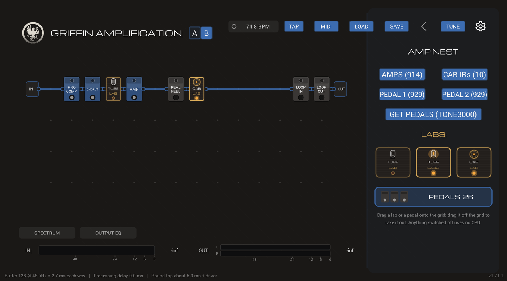
</p>

---

## Contents

- [What it does](#what-it-does)
- [The signal chain](#the-signal-chain)
- [Tube Lab: a real circuit, simulated](#tube-lab-a-real-circuit-simulated)
  - [The chassis](#the-chassis)
  - [Example: what Drive does](#example-what-drive-does)
  - [Example: the debug page's schematic and oscilloscope](#example-the-debug-pages-schematic-and-oscilloscope)
- [Cab Lab: place the mics in 3D](#cab-lab-place-the-mics-in-3d)
- [EQ with a live analyzer](#eq-with-a-live-analyzer)
  - [Example: tightening a high-gain rig](#example-tightening-a-high-gain-rig)
- [Everything else](#everything-else)
- [Built to stay light](#built-to-stay-light)
- [Building from source](#building-from-source)
- [Documentation](#documentation)
- [License and credits](#license-and-credits)

---

## What it does

| | |
|---|---|
| 🎛️ **Amp captures** | Load neural amp captures (`.nam` files) into the AMP block, with A/B slots, a noise gate and a tone stack. Two **CAPTURE** pedals load pedal captures. |
| 🔌 **Patchable chain** | A 4 × 14 grid between IN and OUT. Drag blocks in and cable them in series or parallel. Parallel paths are latency-aligned, so they never comb-filter. |
| 🔥 **Tube Lab** | A 12AX7 preamp (one or two stages), tone stack, phase inverter and push-pull EL34/6L6 power amp into a speaker load, solved as an electrical circuit every sample. |
| 🔬 **Debug page** | A live schematic with the circuit's real voltages, a two-channel oscilloscope on any of 20 probe points, a plain-English readout and a CSV log. |
| 🎤 **CAB LAB** | A speaker cab (modeled or an IR), two mics from six types with position, distance and pan, and a stereo room. |
| 📈 **PRO EQ / Output EQ** | 8-band parametric EQs (bells, shelves, 12-48 dB/oct cuts, notch) with a live IN/OUT spectrum analyzer. |
| 🎚️ **Dynamics** | **GATE** (it can listen to your clean guitar wherever it sits) and **PRO COMP** (Clean, Opto or FET). |
| 🎸 **Pedals** | Comp, OD, Precision Drive, Apex Preamp, Chorus, Flanger, Flange Doubler, Phaser, Tremolo, Wah, Delay, Reverb, Sky Verb, an FX loop, and up to three copies of each effect. |
| 🎹 **MIDI** | Map any knob or switch to a footswitch or an expression pedal, Ableton-style. |
| 🎯 **Tuner, meters, Mono** | A tuner, IN/OUT meters with a clip warning, an output limiter and a Mono output switch. |

---

## The signal chain

Blocks sit on a grid. **Columns are the processing order**, and blocks in the **same column run in
parallel**, each getting the same input. Where paths merge, the faster ones are delayed to line up
with the slowest.

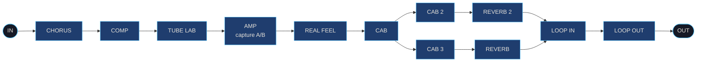

<sub>The chain in the screenshot above: two cab-and-reverb paths in parallel after the amp, merged before the FX loop.</sub>

---

## Tube Lab: a real circuit, simulated

<p align="center">
  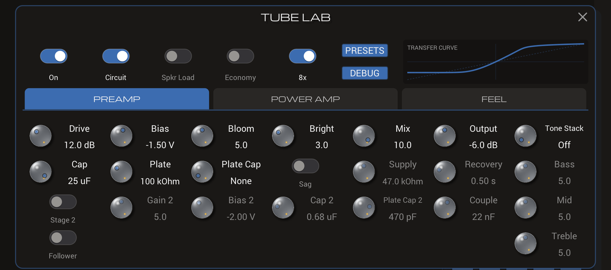
</p>

Most amp sims shape the signal with a curve and add dynamics on top. The Tube Lab solves the circuit
itself instead: a **Dempwolf 12AX7 triode** with its plate resistor, cathode resistor and bypass cap,
coupling caps that charge up and bias the tube colder after hard hits (*blocking*), a supply that sags,
a **tone stack**, a **phase inverter**, a **push-pull power amp** with screen grids and negative
feedback, and a **speaker load** whose impedance changes with frequency. The nonlinear parts are
solved with Newton's method on every oversampled sample (up to 8x).

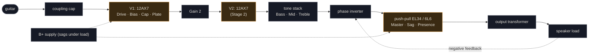

On top of that there are switches for the parts of real amps that shape the feel (cathode follower,
cathode bias, speaker feedback, Resonance) and **Real Feel** options that exaggerate them (screen
squish, shared supply, output-transformer saturation, coil heat). Switched off, the Tube Lab fades out
and goes to sleep, so it costs almost nothing.

### The chassis

<p align="center">
  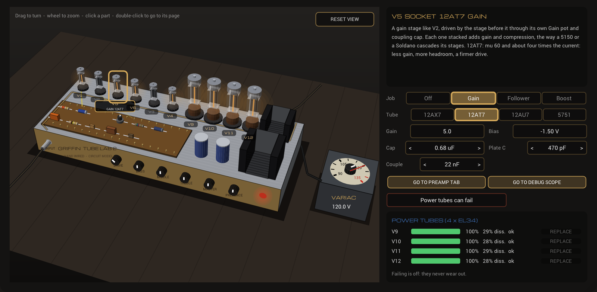
</p>

Opening the Tube Lab shows the whole amp in 3D. Drag to turn it, use the wheel to zoom, and click
any part to see what it does and set it:

- **Preamp tubes:** V1 to V6, glowing with their heaters and pulsing with the signal. The two spare
  sockets, **V5** and **V6**, take a 12AX7, 12AT7, 12AU7 or 5751 as an extra gain stage, a cathode
  follower or a boost.
- **Power tubes:** a pair, or all four (**V9-V12**) for a quad like a 100 W head. With failing switched
  on, each tube wears on its own and can be replaced.
- **The turret board:** the preamp's caps and resistors, drawn as the real parts, with resistor colour
  bands for their actual values.
- **The Variac:** the mains voltage, 90 to 135 V.

Double-click a part to jump to its knobs or to its probe on the debug scope.

### Example: what Drive does

The same plucked A string (110 Hz) through the Tube Lab at three settings. The top row is the
waveform; the bottom row is the harmonics a pure 110 Hz sine comes out with.

<p align="center">
  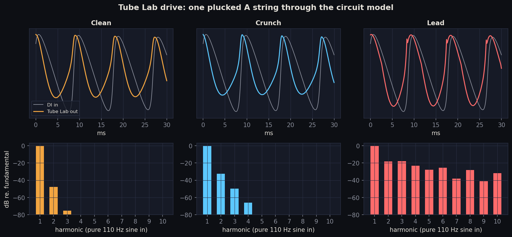
</p>

| Setting | Drive | Stage 2 | What you hear |
|---|---|---|---|
| **Clean** | 0 dB | off | Almost no harmonics: the 2nd is 48 dB down. Warm, not dirty. |
| **Crunch** | 12 dB | off | Mostly 2nd and 3rd harmonics: the tube's asymmetric, even-order edge. |
| **Lead** | 24 dB | on | A full series of harmonics only 20-40 dB down: V1's grid clamps and V2 clips. |

The asymmetry comes from the tube itself. Push the grid toward positive and it starts drawing current
and clamps; swing it negative and the tube cuts off more gently. The Tube Lab's transfer-curve plot
shows exactly that:

<p align="center">
  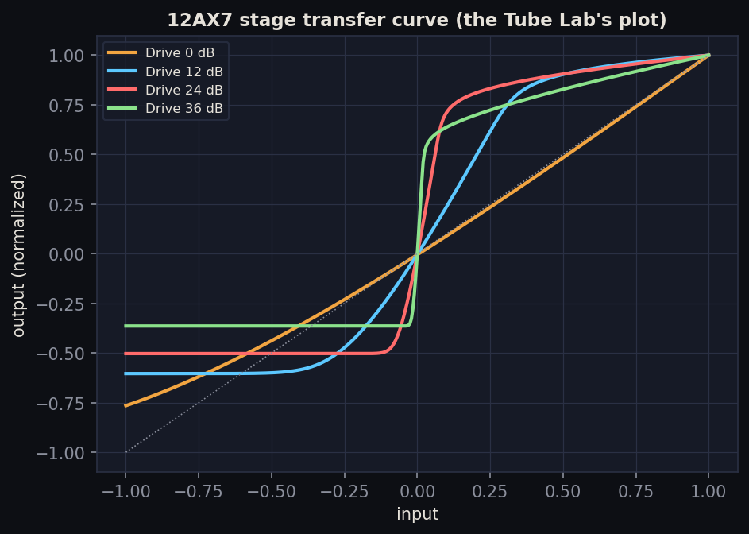
</p>

### Example: the debug page's schematic and oscilloscope

**DEBUG** (under PRESETS in the Tube Lab) opens a page that measures the simulation while you play:

<p align="center">
  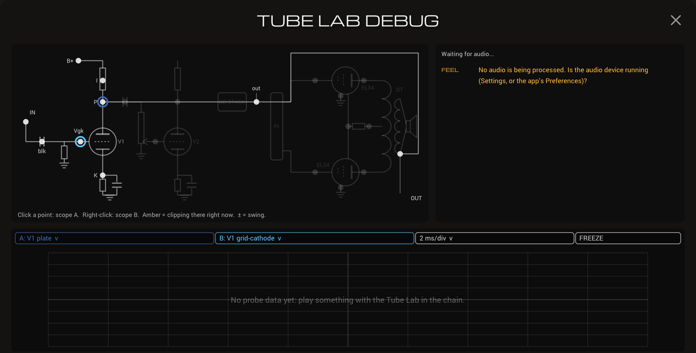
</p>

- **Circuit map:** the schematic, from the input cap through V1, V2, the tone stack, the phase
  inverter and both power tubes to the speaker. Every probe point shows its live voltage and swing,
  and turns **amber** while that part is clipping. Click a point to put it on the scope.
- **Readout:** plain English, 4 times a second: the overall feel (Clean to Saturated), where each tube
  is biased, how far it swings, how much of the time it clips and on which side, blocking, sag and CPU.
- **Oscilloscope:** two channels on any of 20 probe points, triggered (0.5-20 ms/div) or scrolling
  (50-200 ms/div), with FREEZE.
- **CSV log:** every setting and measurement, 4 rows a second, for comparing tones later.

Here is what those probe points read for the **Lead** setting above. This is the same data the scope
shows, recorded from the Tube Lab's probes:

<p align="center">
  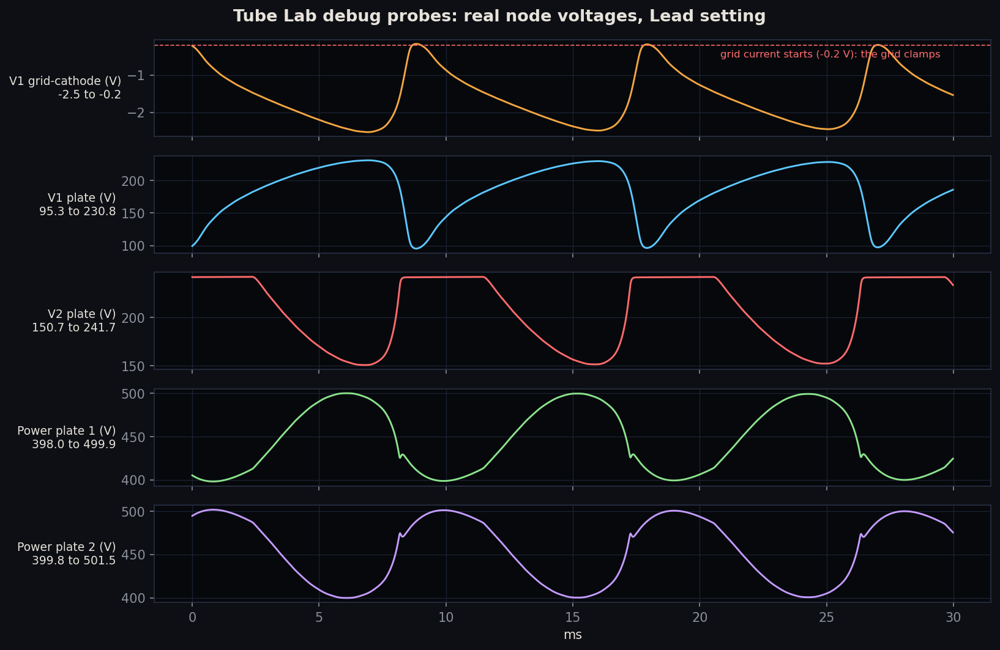
</p>

Reading it from the top:

1. **V1 grid-cathode** rises to **-0.2 V** and flattens there on every cycle. That's grid current: the
   grid clamps the signal and the coupling cap charges, which is what *blocking* is.
2. **V1 plate** swings from about 95 V to 231 V. Its sharp dips are the clamped peaks, inverted.
3. **V2 plate** runs flat against its ceiling for half of each cycle: the second stage is clipping
   hard, which is where most of the Lead harmonics come from.
4. **The power-tube plates** move in opposite directions (push-pull), between about 400 V and 500 V.

The probes cost about 6% of the Tube Lab's CPU, and only while the page is open or the log is
running. The sound is bit-for-bit the same with them on or off.

---

## Cab Lab: place the mics in 3D

<p align="center">
  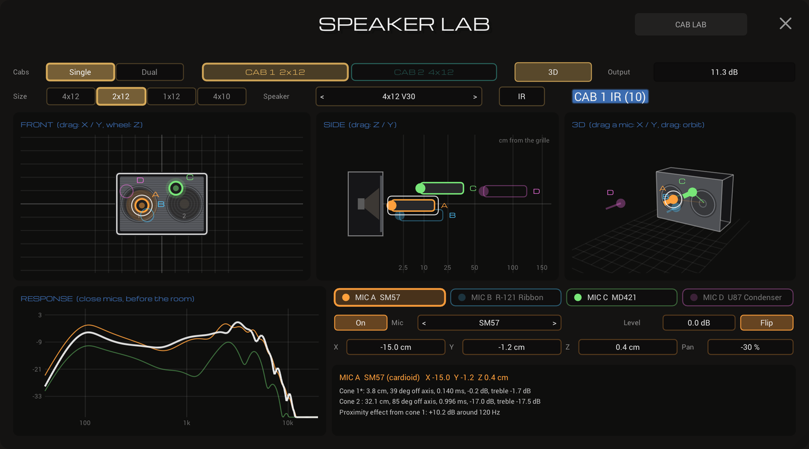
</p>

**CAB LAB** models the speaker cab and the mics on it. Its **SPEAKER LAB** page shows the cab from
the front, the side and in 3D, and you drag the mics where you want them:

- **Cabs:** 4x12, 2x12, 1x12 or 4x10, with a choice of speakers, or your own IR. Switch to **Dual** for
  two cabs at once, and put each mic on either one.
- **Four mics** from ten types (SM57, R-121 ribbon, MD421, U87, C414 and more). Each has its own X, Y
  and Z (distance from the grille), level, pan and polarity flip.
- **What you hear, explained:** the response graph shows each close mic and the blend. The readout
  says how far the mic is from each cone, how far off axis, and how much proximity bass it picks up.

---

## EQ with a live analyzer

<p align="center">
  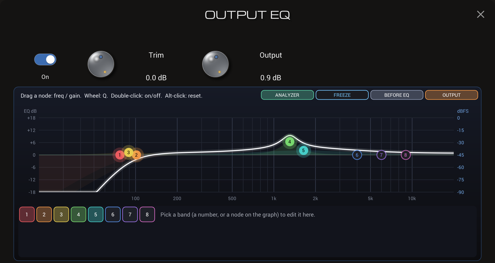
</p>

Two EQs share one engine: **PRO EQ**, a block you can place anywhere in the chain, and the
**Output EQ**, the last thing before Master Out. Each has 8 bands, and any band can be a bell, a low
or high shelf, a 12-48 dB/oct low or high cut, or a notch. Drag a node to set its frequency and gain,
use the mouse wheel for Q, and double-click to switch a band on or off. Moves glide, so nothing
zippers or clicks, and the curve on screen is computed from the same filters the audio runs.

The **ANALYZER** shows the spectrum going in and coming out. It starts off and remembers your
choice, so it only uses CPU and GPU when you want it.

### Example: tightening a high-gain rig

Four bands: cut the low end below 90 Hz, take 4 dB of mud out at 320 Hz, add 3 dB of bite at 1.7 kHz,
and roll off the fizz above 7 kHz.

<p align="center">
  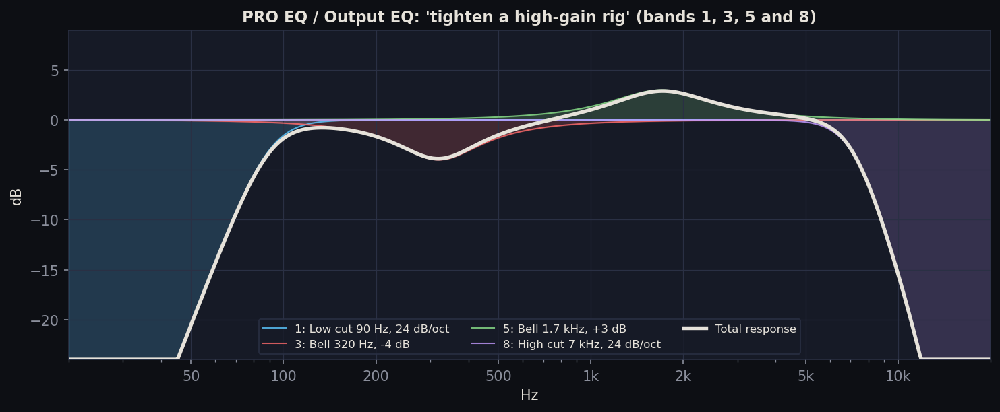
</p>

The Lead tone from the Tube Lab example, through that EQ, as the analyzer's IN/OUT view shows it:

<p align="center">
  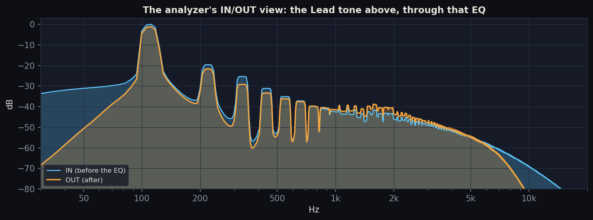
</p>

The rumble under 90 Hz drops by 30 dB or more, the harmonics around 300 Hz come down, the 1-2 kHz
range comes forward, and the top octave falls away instead of fizzing.

---

## Everything else

- **Cab IRs:** besides CAB LAB, there are three IR loaders: CAB, CAB 2 and CAB 3.
- **Capture packs:** the **PACK** dropdown in the AMP block switches between the captures of one pack
  (a folder or a `.zip`), level-matched.
- **Tap tempo:** **TAP** in the top bar (or a footswitch) sets the tempo, and each delay follows it as
  a 1/4, dotted 1/8, 1/8, triplet or 1/16 note.
- **GATE and PRO COMP:** a gate that can key off your clean guitar even when it sits after a
  high-gain amp, and a studio compressor with Clean, Opto and FET styles and a gain-reduction meter.
- **Pedals:** up to three copies of each effect, each with its own knobs and popup.
- **A/B amp slots:** two amp captures, each with its own cab IRs, switchable instantly.
- **MIDI:** click **MIDI** in the top bar to map footswitches and expression pedals to any knob or switch.
- **Output:** Master Out, a lookahead limiter (0.7 ms), a soft safety clip, and stereo **Width** (0%
  sums left and right for a single speaker).
- **Themes:** several color themes, in light or dark.

---

## Built to stay light

- Anything you can't see or haven't switched on doesn't run: the debug probes, the spectrum
  analyzers and the tuner's pitch search all stop when they're hidden, and blocks that are off or
  not cabled in are skipped.
- The amp-capture engine has a hand-written SSE kernel plus an AVX2/FMA one picked at run time
  (about 5x faster than the generic matrix code), and cab IRs use a zero-latency partitioned FFT.
- The UI only redraws what changes, clipped in hardware, so the meters don't redraw the whole window.
- On an ordinary laptop, a full rig runs at a 128-sample buffer: about 5.3 ms round trip plus the
  interface's driver.

---

## Building from source

Windows x64 with the Visual Studio 2019 Build Tools. The libraries are git submodules pinned to the
commits this was built on, and the changes to them are kept as patches in [`patches/`](patches/).

```powershell
git clone --recursive https://github.com/Gwojtowicz/Griffin-Amplification.git
cd Griffin-Amplification
powershell -ExecutionPolicy Bypass -File scripts\apply-patches.ps1     # or: bash scripts/apply-patches.sh
cd iPlug2/Dependencies/IPlug; bash ./download-vst3-sdk.sh v3.8.1_build_84; cd ../../..
cd iPlug2/Dependencies; bash ./download-prebuilt-libs.sh; cd ../..

cd NeuralAmpModeler
MSBuild.exe NeuralAmpModeler.sln /t:NeuralAmpModeler-app  /p:Configuration=Release /p:Platform=x64 /p:PlatformToolset=v142
MSBuild.exe NeuralAmpModeler.sln /t:NeuralAmpModeler-vst3 /p:Configuration=Release /p:Platform=x64 /p:PlatformToolset=v142
```

The app ends up in `NeuralAmpModeler/build-win/app/x64/Release/`. (The source folders keep their
original names, so the build and saved settings stay compatible.) The VST3's last build step copies
it into `C:\Program Files\Common Files\VST3`, which needs an admin prompt. See the
[manual](docs/MANUAL.md#building) for details.

---

## Documentation

- **[The full manual](docs/MANUAL.md):** every block and setting, the Tube Lab's circuit math stage by
  stage, oversampling, levels, MIDI and the saved-state format.
- **[CHANGELOG.md](CHANGELOG.md):** every version, with measurements.

---

## License and credits

Griffin Amplification is open source under the **MIT license**: see [LICENSE](LICENSE).

It's built on Steven Atkinson's open-source amp-modeling plug-in and core library
([source](https://github.com/sdatkinson/NeuralAmpModelerPlugin), MIT), whose copyright notice is kept
in [LICENSE](LICENSE) as that license requires. It's an independent project and isn't affiliated with
or endorsed by the original authors. The bundled libraries keep their own licenses:
[iPlug2](https://iplug2.github.io) (zlib-style), the core amp-model library and AudioDSPTools (MIT),
Eigen (MPL-2.0) and the VST3 SDK (MIT). See `NeuralAmpModeler/installer/ThirdPartyNotices.txt`.

The Tube Lab and tuner build on published research:
K. Dempwolf and U. Zölzer, *A Physically-motivated Triode Model for Circuit Simulations* (DAFx 2011);
N. Koren, *Improved VT models for SPICE simulations*; P. McLeod and G. Wyvill, *A Smarter Way to Find
Pitch*; R. Bristow-Johnson, *Audio EQ Cookbook*.
