<p align="center">
  
</p>

<h1 align="center">Griffin Amplification</h1>

<h3 align="center">A free guitar amp you can see inside.</h3>

<p align="center">
  <a href="https://github.com/Gwojtowicz/Griffin-Amplification/releases/latest"><b>Download for Windows</b></a>
  &nbsp;·&nbsp; <a href="#nam-and-tone3000">NAM + TONE3000</a>
  &nbsp;·&nbsp; <a href="#the-math">The math</a>
  &nbsp;·&nbsp; <a href="docs/MANUAL.md">Manual</a>
</p>

<p align="center">
  
  
  
  <a href="https://www.neuralampmodeler.com"></a>
  <a href="https://www.tone3000.com"></a>
</p>

<p align="center">
  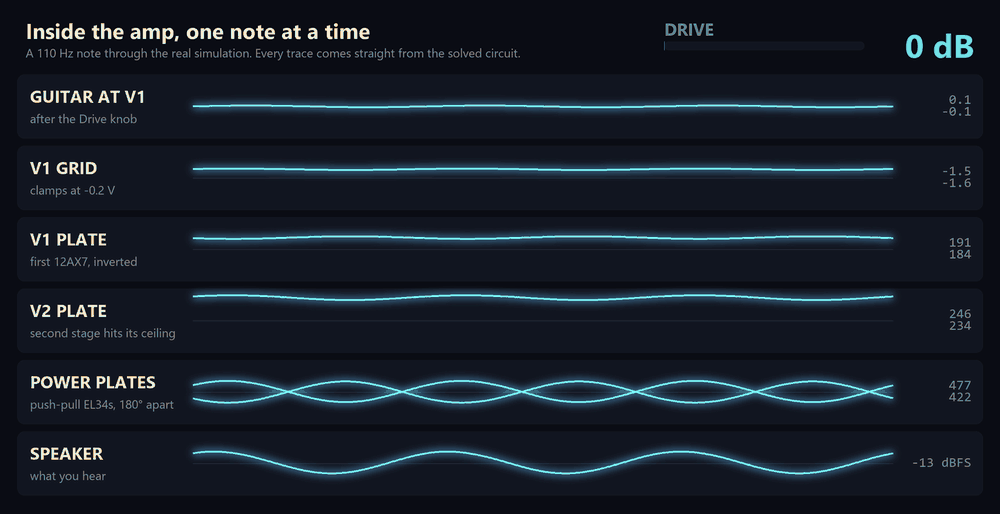
</p>

<p align="center"><sub>Recorded from the simulation's own probes: the same voltages the debug page shows while you play.</sub></p>

---

## NAM and TONE3000

**Griffin Amplification is built on [Neural Amp Modeler (NAM)](https://www.neuralampmodeler.com), and
[TONE3000](https://www.tone3000.com) is where your tones come from.**

NAM is Steven Atkinson's open-source engine for neural amp captures: it learns a real amp or pedal and
plays it back. TONE3000 is the community library where players share those captures and cab IRs, free.
Download a tone there and it plugs straight in here:

| Where it goes | What it does with a capture from TONE3000 |
|---|---|
| **AMP block** | Plays a NAM capture of an amp, with A/B slots, a noise gate and a tone stack. |
| **PACK dropdown** | Unzip a TONE3000 pack and switch between its captures, level-matched. |
| **CAPTURE pedals** | Two more slots for NAM captures of pedals. **GET PEDALS (TONE3000)** opens the site. |
| **[AMP Capture](#amp-capture-a-capture-as-the-preamp-1640)** | Runs a NAM capture inside the Tube Lab, in place of its preamp tubes, so the simulated power amp, bias and Variac all act on it. |
| **CAB and CAB LAB** | Loads cab IRs (`.wav`). |

So you can play a captured amp and a simulated one in the same chain, or put one inside the other.

---

## What's inside

<table>
  <tr>
    <td width="50%"><a href="#the-chassis">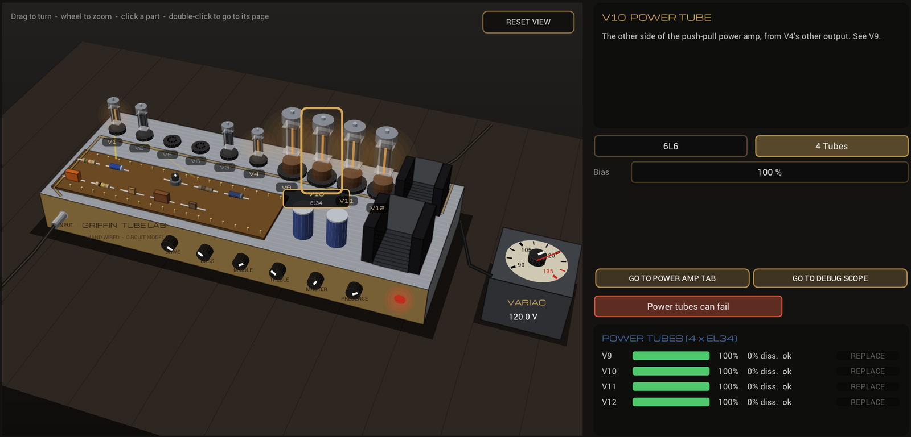</a><br><b>The chassis.</b> Every tube, cap and resistor, in 3D. Click a part to set it.</td>
    <td width="50%"><a href="#the-modular-chassis-fourteen-amps">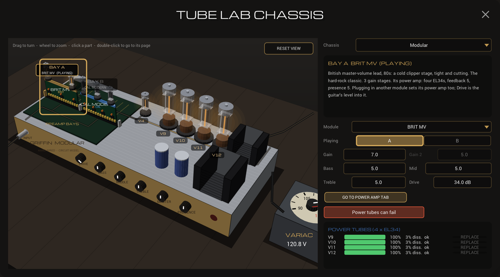</a><br><b>Fourteen preamps.</b> Modules built stage by stage from schematics, swapped like memory sticks.</td>
  </tr>
  <tr>
    <td><a href="#example-the-debug-pages-schematic-and-oscilloscope">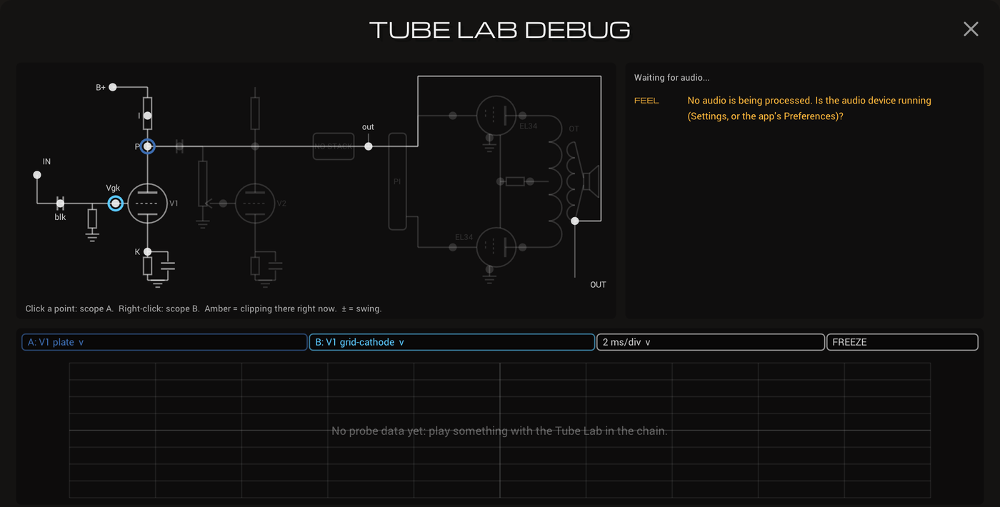</a><br><b>The debug page.</b> A live schematic, 20 probe points and a two-channel scope.</td>
    <td><a href="#example-the-debug-pages-schematic-and-oscilloscope">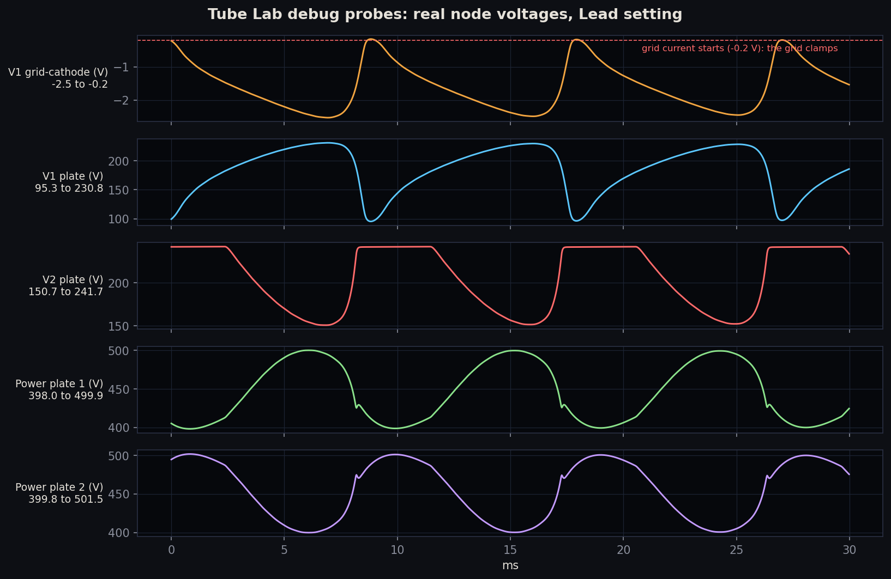</a><br><b>The probes.</b> Grids clamping, plates clipping, push-pull swinging.</td>
  </tr>
  <tr>
    <td><a href="#tube-lab-a-real-circuit-simulated">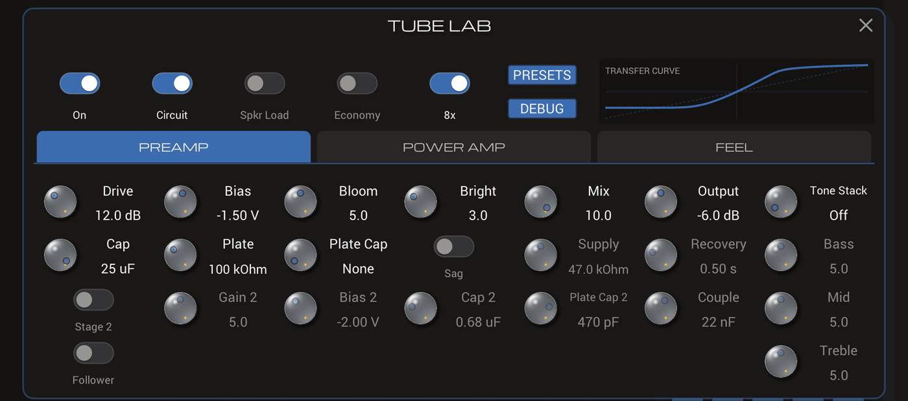</a><br><b>The Tube Lab.</b> The knobs are real parts: bias, caps, plate resistor, supply.</td>
    <td><a href="#example-what-drive-does">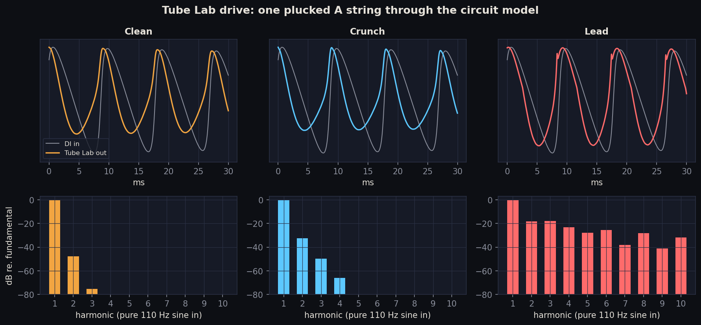</a><br><b>The harmonics.</b> What Drive does to the wave and its spectrum.</td>
  </tr>
  <tr>
    <td><a href="#cab-lab-place-the-mics-in-3d">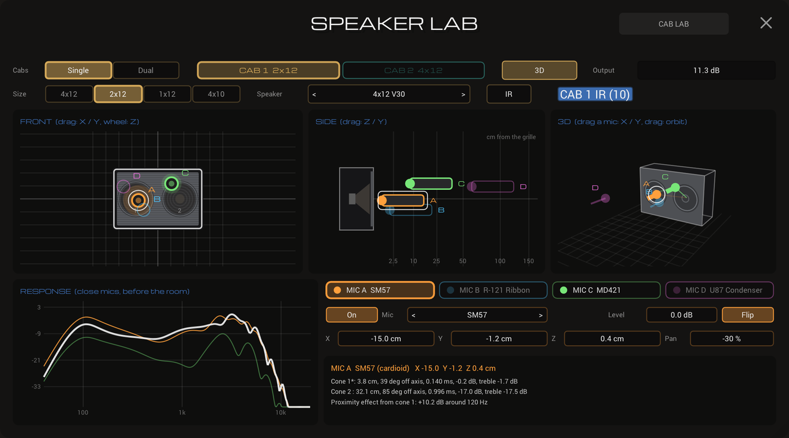</a><br><b>The cab.</b> Drag four mics around a speaker cab.</td>
    <td><a href="#eq-with-a-live-analyzer">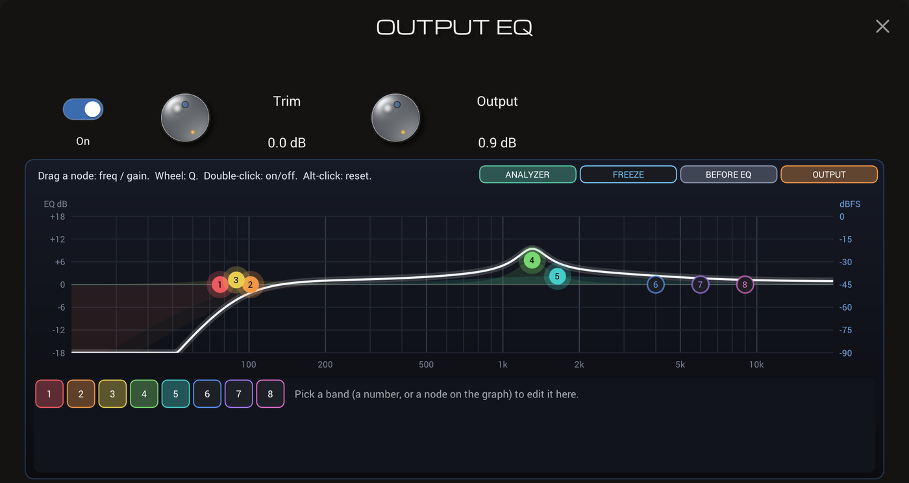</a><br><b>The EQ.</b> Eight bands over a live spectrum.</td>
  </tr>
</table>

Every picture here is a screenshot or the simulation's own output, and [every formula](#the-math) is on this
page, next to the source file that runs it. It's free and MIT-licensed, and it needs no account.

---

## Contents

- [NAM and TONE3000](#nam-and-tone3000)
- [What it does](#what-it-does)
- [The signal chain](#the-signal-chain)
- [Tube Lab: a real circuit, simulated](#tube-lab-a-real-circuit-simulated)
  - [The math](#the-math): every stage, equation and measurement
    - [Why simulate the circuit](#why-simulate-the-circuit)
    - [Stage 1: one 12AX7 gain stage](#stage-1-one-12ax7-gain-stage)
    - [Stage 2: the cascaded stage](#stage-2-the-cascaded-stage)
    - [The power amp](#the-power-amp)
    - [Speaker load](#speaker-load)
    - [Real Feel switches](#real-feel-switches)
    - [60 Hz: supply ripple, grind and hum](#60-hz-supply-ripple-grind-and-hum-1390-grind-1400)
    - [Circuit+](#circuit-1450)
    - [The bench: Variac, bias pot, tube age](#the-bench-variac-bias-pot-tube-age-1580)
    - [Power tubes that fail](#power-tubes-that-fail-1620)
    - [AMP Capture](#amp-capture-a-capture-as-the-preamp-1640)
    - [Presets](#presets-1630)
    - [Oversampling](#oversampling)
    - [Levels](#levels)
    - [The Classic engine](#the-classic-engine)
  - [The chassis](#the-chassis)
  - [The MODULAR chassis: fourteen amps](#the-modular-chassis-fourteen-amps)
  - [Example: what Drive does](#example-what-drive-does)
  - [Example: the debug page's schematic and oscilloscope](#example-the-debug-pages-schematic-and-oscilloscope)
- [Cab Lab: place the mics in 3D](#cab-lab-place-the-mics-in-3d)
- [EQ with a live analyzer](#eq-with-a-live-analyzer)
  - [Example: tightening a high-gain rig](#example-tightening-a-high-gain-rig)
- [Everything else](#everything-else)
- [Built to stay light](#built-to-stay-light)
- [Building from source](#building-from-source)
- [Documentation](#documentation)
- [License and credits](#license-and-credits)

---

## What it does

| | |
|---|---|
| 🎛️ **NAM captures** | Load [NAM](https://www.neuralampmodeler.com) captures (`.nam` files, thousands of them on [TONE3000](https://www.tone3000.com)) into the AMP block, with A/B slots, a noise gate and a tone stack. Two **CAPTURE** pedals load pedal captures. |
| 🔌 **Patchable chain** | A 4 × 14 grid between IN and OUT. Drag blocks in and cable them in series or parallel. Parallel paths are latency-aligned, so they never comb-filter. |
| 🔥 **Tube Lab** | A 12AX7 preamp (one or two stages), tone stack, phase inverter and push-pull EL34/6L6 power amp into a speaker load, solved as an electrical circuit every sample. |
| 🔬 **Debug page** | A live schematic with the circuit's real voltages, a two-channel oscilloscope on any of 20 probe points, a plain-English readout and a CSV log. |
| 🎤 **CAB LAB** | A speaker cab (modeled or an IR), two mics from six types with position, distance and pan, and a stereo room. |
| 📈 **PRO EQ / Output EQ** | 8-band parametric EQs (bells, shelves, 12-48 dB/oct cuts, notch) with a live IN/OUT spectrum analyzer. |
| 🎚️ **Dynamics** | **GATE** (it can listen to your clean guitar wherever it sits) and **PRO COMP** (Clean, Opto or FET). |
| 🎸 **Pedals** | Comp, OD, Tight Drive, Hi-Gain Preamp, Chorus, Flanger, Flange Doubler, Phaser, Tremolo, Wah, Delay, Reverb, Sky Verb, an FX loop, and up to three copies of each effect. |
| 🎹 **MIDI** | Map any knob or switch to a footswitch or an expression pedal, Ableton-style. |
| 🎯 **Tuner, meters, Mono** | A tuner, IN/OUT meters with a clip warning, an output limiter and a Mono output switch. |

---

## The signal chain

<p align="center">
  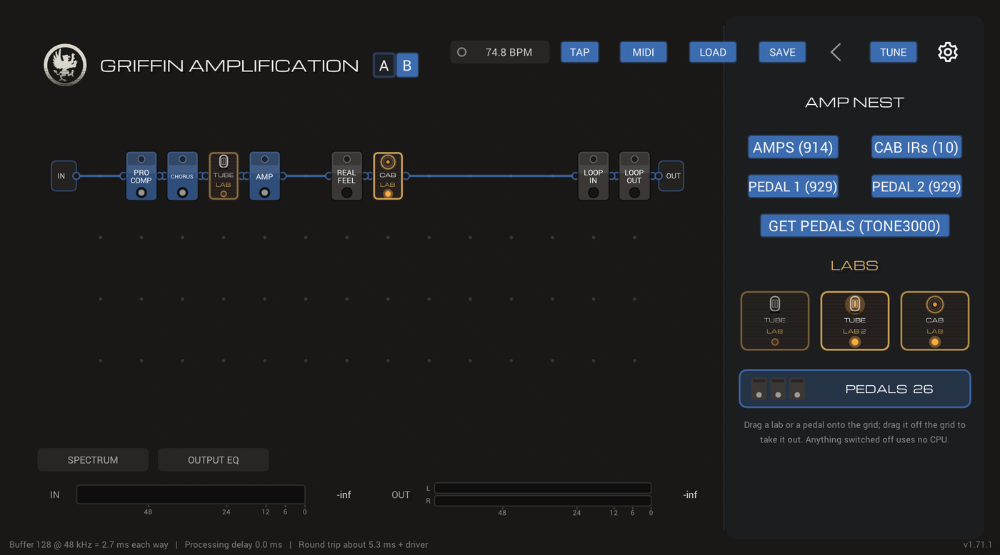
</p>

Blocks sit on a grid. **Columns are the processing order**, and blocks in the **same column run in
parallel**, each getting the same input. Where paths merge, the faster ones are delayed to line up
with the slowest.

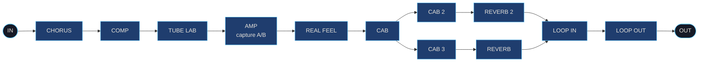

<sub>The chain in that screenshot: two cab-and-reverb paths in parallel after the amp, merged before the FX loop.</sub>

---

## Tube Lab: a real circuit, simulated

<p align="center">
  
</p>

Most amp sims shape the signal with a curve and add dynamics on top. The Tube Lab solves the circuit
itself instead: a **Dempwolf 12AX7 triode** with its plate resistor, cathode resistor and bypass cap,
coupling caps that charge up and bias the tube colder after hard hits (*blocking*), a supply that sags,
a **tone stack**, a **phase inverter**, a **push-pull power amp** with screen grids and negative
feedback, and a **speaker load** whose impedance changes with frequency. The nonlinear parts are
solved with Newton's method on every oversampled sample (up to 8x).

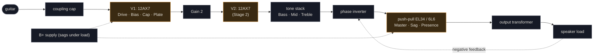

On top of that there are switches for the parts of real amps that shape the feel (cathode follower,
cathode bias, speaker feedback, Resonance) and **Real Feel** options that exaggerate them (screen
squish, shared supply, output-transformer saturation, coil heat). Switched off, the Tube Lab fades out
and goes to sleep, so it costs almost nothing.

### The math

Source files: [`TubeStage.h`](NeuralAmpModeler/TubeStage.h) (the block: oversampling, knobs, both
engines), [`TubeCircuit.h`](NeuralAmpModeler/TubeCircuit.h) (the 12AX7 stage), and
[`PowerAmp.h`](NeuralAmpModeler/PowerAmp.h) (the push-pull power amp and speaker load).

#### Why simulate the circuit

The simple way to model a tube is a static curve, output = f(input), with effects such as "sag" or
"bloom" added on top as envelope followers. That approach produces the tube's distortion, but the
added effects behave like a compressor. In a real amp the feel comes from the parts interacting:
- a coupling cap charges when the grid conducts,
- the cathode cap sets which frequencies get full gain,
- the supply droops when the tubes draw more current.

The default **Circuit** engine therefore does not script any of these behaviors. It describes the
actual schematic and solves it for the node voltages at every sample, and the behaviors come out of
that solution. The knobs set component values (resistors and caps).

#### Stage 1: one 12AX7 gain stage

```
 Vin --Cin--+--Rstop(68k)--G            B+ --Ra-- P --Cc(22n)--+-- out
            |              | \                    |            |
          Rgl(1M)        Cgk  Cgp                 |          Rl(1M)  (next stage's grid leak)
            |              |    \                 |            |
           gnd             K-----+--- 12AX7 ------+           gnd
                           |
                        Rk || Ck   (cathode bias + bypass cap)
                           |
                          gnd
```

**The tube model.** The stage uses the Dempwolf & Zoelzer 12AX7 model (*"A Physically-motivated
Triode Model for Circuit Simulations"*, DAFx 2011). It was fitted to measured tubes, and it includes
**grid current**:

```math
I_k = G\left(\frac{\ln\left(1 + e^{C\,(V_{pk}/\mu + V_{gk})}\right)}{C}\right)^{\gamma}
\qquad
I_g = G_g\left(\frac{\ln\left(1 + e^{C_g V_{gk}}\right)}{C_g}\right)^{\xi} + I_{g0}
\qquad
I_p = I_k - I_g
```

with G = 2.242e-3, C = 3.40, μ = 103.2, γ = 1.26, G<sub>g</sub> = 6.177e-4, C<sub>g</sub> = 9.901,
ξ = 1.314, I<sub>g0</sub> = 8.025e-8.

The `ln(1 + e^x)` term (softplus) is a smooth version of `max(0, x)`. Where it is positive, the
current follows a 3/2-type power law. Where it is negative, the tube cuts off smoothly with no hard
corner, which matters because Newton's method needs smooth derivatives. Grid current is near zero
while the grid is negative. Once the grid goes above the cathode it rises steeply, so the grid acts
like a diode. That diode clamps the input signal and charges the input cap.

**Lookup tables.** The cathode current depends only on one combined voltage,
`u = Vpk/μ + Vgk`. The grid current depends only on `Vgk`. Both are therefore functions of a single
variable, and each is tabulated once at startup (16,384 points over u in [-8, 8] V and V<sub>gk</sub>
in [-3, 6] V). Each table stores the value and its derivative, and lookups interpolate linearly. Per
sample, no `exp`/`log`/`pow` call is made. Values outside the tables use the exact formula.

**Capacitors: trapezoidal companion models.** For one sample step T, each capacitor C is replaced
by a resistor in parallel with a current source:

```math
i_n = g\,v_n - i_{eq},\qquad g = \frac{2C}{T},\qquad i_{eq} \leftarrow g\,v_n + i_n
```

This is the trapezoidal rule (the same as the bilinear transform). It is stable at any step size, so
it doesn't blow up on a stiff circuit. After this replacement, each sample is a purely
**resistive** circuit with known current sources, plus the tube.

**Modified nodal analysis + Newton-Raphson.** The circuit has five unknown node voltages: A (after
Cin), G (grid), K (cathode), P (plate) and O (output). Kirchhoff's current law says the currents
leaving each node add up to zero:

```math
F(\mathbf{v}) = G_{lin}\,\mathbf{v} - \mathbf{s} + \mathbf{i}_{tube}(\mathbf{v}) = 0
```

- G<sub>lin</sub> is the conductance matrix of the resistors and cap companions. It is built once,
  when a knob changes.
- **s** holds the sources: the input voltage, the cap histories, and B+ through R<sub>a</sub>.
- **i**<sub>tube</sub> is the triode: I<sub>g</sub> leaves G, I<sub>p</sub> leaves P, and I<sub>k</sub>
  arrives at K.

Each sample, Newton's method solves `J Δv = -F` with a 5x5 Gaussian elimination. The Jacobian J is
G<sub>lin</sub> plus the tube's partial derivatives (∂I<sub>k</sub>/∂V<sub>gk</sub>,
∂I<sub>k</sub>/∂V<sub>pk</sub>, ∂I<sub>g</sub>/∂V<sub>gk</sub>), which come straight from the
tables. The solver details:
- It starts from the previous sample's voltages. At 176-192 kHz consecutive samples are close, so it
  needs only a few iterations, with a maximum of 8.
- Each node's step is limited to 100 V per iteration, only as a sanity limit. (Until 1.32.3 the
  input, grid and cathode were held to 2 V per iteration. A cascaded stage 2's input follows stage
  1's plate, which can move tens of volts in one sample, and 8 iterations of 2 V couldn't catch up.
  The solve stopped short, by up to -20 dB re the peak on Modern High Gain. The Dempwolf model grows
  only polynomially past its knees, so plain Newton steps are safe there.)
- It stops when no node moves by more than 10 µV.

**Bias.** The **Bias** knob sets the resting grid-to-cathode voltage. The code then finds the
cathode resistor that produces it, as an amp designer would. It bisects on the plate current until
the load line `Vp = B+ - Ra·Ip` and the tube agree at that V<sub>gk</sub>, then sets
`Rk = -Vbias / Ik`. At the default -1.5 V with a 100k plate, this gives the textbook operating point:
R<sub>k</sub> ≈ 2.3k, plate ≈ 187 V, 0.65 mA, and a gain of about 60.

On reset, the DC operating point is solved with the caps open (40 Newton iterations), and each cap
is pre-charged to its resting voltage. The stage therefore starts silent, with no turn-on thump.

**What each part does, and which knob sets it:**

| Part | Knob | What it does |
|---|---|---|
| Input coupling cap C<sub>in</sub> | **Bloom** (2.2-220 nF, log) | When the grid conducts, I<sub>g</sub> charges C<sub>in</sub>, which pushes the grid colder. The cap then bleeds back through the 1M grid leak. This is **blocking**: the choke after a hard pick and the "bloom" as the note recovers. A bigger cap blocks for longer. |
| Grid stopper 68k + C<sub>gk</sub> 1.6 pF, C<sub>gp</sub> 1.7 pF | (fixed) | C<sub>gp</sub> is multiplied by the stage gain (**Miller effect**), which creates a treble roll-off. The stopper limits grid current, which softens the clamp. |
| Cathode R<sub>k</sub> | **Bias** | The operating point, and therefore headroom and how symmetrically the stage clips. |
| Cathode bypass C<sub>k</sub> | **Cap** (None, 0.68-25 µF) | Above the corner frequency `1/(2π Rk Ck)`, the cathode is grounded for AC and the stage has full gain. Below it, R<sub>k</sub> applies local negative feedback, so the bass gets less gain. A small cap gives a tight, bright stage. With no cap the stage is about 8 dB quieter and cleaner. |
| Plate load R<sub>a</sub> | **Plate** (47-220k) | Gain and headroom (the slope of the load line). |
| Plate cap (across R<sub>a</sub>) | **Plate Cap** (None, 47 pF-1 nF) | Rolls off fizz. With R<sub>a</sub> ‖ r<sub>p</sub> ‖ load ≈ 38k, 470 pF gives a corner near 9 kHz. |
| Supply resistance + reservoir | **Sag**, **Supply**, **Recovery** | B+ is a node fed through R<sub>s</sub>. Its time constant is tenths of a second, about 10,000 samples, so it is updated explicitly after each solve: `V_rail += k·(V_supply - Rs·I - V_rail)`. A single preamp stage barely sags, as in a real amp. Real sag comes from the power amp. |
| Output coupling cap 22 nF into 1M | (fixed) | Blocks the DC from the plate. Asymmetric clipping shifts the average voltage, and this cap is what lets that shift move the next stage's bias. |

**Grid current** is the most important part of the model. Most tube models leave it out, and
without it there is no clamping, no blocking, and no dynamic bias shift.

#### Stage 2: the cascaded stage

With **Stage 2** on, stage 1's plate swing goes through the **Gain 2** pot into a second, identical
circuit. The pot uses an audio taper, gain = position², which approximates a log pot. The two stages
interact in two ways:

- **Interstage blocking.** Stage 2's input cap (**Couple**) is driven from stage 1's real output
  resistance, R<sub>a</sub> ‖ r<sub>p</sub> ≈ 38k. In the code, C<sub>in</sub> becomes one conductance
  in series with that source resistance: `g = 1 / (Rsource + 1/g_Cin)`. When stage 2's grid conducts,
  the cap therefore charges at the real circuit's rate. This is where high-gain preamp choke comes
  from. Measured at the default 22 nF: a soft note after a hard hit dips about 10 dB for 20 ms. At
  220 nF it chokes by about 30 dB and recovers over about 0.5 s.
- **Shared supply.** Both stages draw from the same B+ node. Stage 2 reads stage 1's rail voltage
  each sample and reports its own current draw back, so with Sag on, playing harder through stage 2
  also sags stage 1.

Stage 2 defaults to a slightly colder bias (-2.0 V), a small 0.68 µF cathode cap and a 470 pF plate
cap. These are the classic tight, fizz-tamed second stage of high-gain designs.

#### The power amp

```
 in --Master--> phase inverter (long-tail pair) --+--> grid 1 (+) --> pentode 1 --+
                     ^                            +--> grid 2 (-) --> pentode 2 --+--> output transformer --> out
                     |                                                            |
                     +------ negative feedback (Feedback; Presence = less of it up top) ---+
 B+  <-- rectifier + supply R + 40 uF reservoir (Sag)    -- drawn on by both plates
 Vg2 <-- screen resistor + 40 uF                         -- drawn on by both screens
```

**Pentode model (Koren).**

```math
I_p = \frac{2}{K_{g1}}\,E_1^{E_x}\,\arctan\!\left(\frac{V_p}{K_{vb}}\right),
\qquad
E_1 = \frac{V_{g2}}{K_p}\,\ln\!\left(1 + e^{K_p\left(\frac{1}{\mu} + \frac{V_{g1}}{V_{g2}}\right)}\right)
```

This factors into three parts: `(V_g2/K_p)^Ex`, a function of the single variable
`x = 1/μ + V_g1/V_g2`, and `arctan(V_p/K_vb)`, the plate "knee" below which current collapses. The
two 1-D functions are tabulated with their slopes, and the V<sub>g2</sub> factor is computed once
per sample. The EL34 and 6L6 use Koren's published constants. The bias is found by bisection so that
each tube idles at 35 mA (EL34) or 40 mA (6L6). This is a fixed, cold-ish class AB bias, so on big
swings one tube cuts off: crossover.

**Push-pull through the transformer.** Each plate sees a quarter of the 3.4k plate-to-plate load
(R<sub>L</sub> = 850 Ω), with opposite signs:

```math
V_{p1} = B^+ - R_L D,\qquad V_{p2} = B^+ + R_L D,\qquad D = I_{p1} - I_{p2}
```

The difference current D is what drives the speaker. The only unknown per sample is D, so Newton
solves the scalar equation `f(D) = D - (Ip1(D) - Ip2(D)) = 0`, warm-started. Since 1.33.0 it's a
safeguarded Newton: each grid's equation is solved exactly for the current D (it falls monotonically
in the grid voltage and is concave, so Newton converges from anywhere, and below -2 V it's linear and
solved directly). That leaves f rising monotonically in D, so once f has been seen on both sides of
zero, the root is bracketed and any step that reaches the bracket's far end bisects it instead. It
takes up to 16 iterations; most samples need 2-4. The old solver, a plain Newton with a fixed ±50 mA
step limit, could bounce between two points forever when one tube was cut off and the other's grid
was conducting. Plexi Crunch's output was off by up to -17 dB re its peak.

The second tube is scaled by 0.96. Real pairs are never perfectly matched, and a perfect pair cancels
the even harmonics completely (measured at -134 dB). The 4% mismatch keeps a little even-harmonic
warmth.

**Phase inverter.** The long-tail pair is modeled as `PI = 70 V · tanh(u / 70 V)`. It feeds +PI to
one grid and -PI to the other, and soft-clips when pushed. **Master** sets
`u = (2 + 78·master²) · (input - feedback)`, a quadratic taper like a real pot.

**Negative feedback is implicit.** Feedback is part of the Newton equation for *this* sample:
`u = drive · (in - β·y(D))`, where the output y depends on the D being solved for. Its derivative
enters the Jacobian (`dU/dD`). A one-sample-delayed feedback loop would ring or go unstable at high
feedback. The implicit version can't. **Feedback** sets β from 0 to 2 (a loop gain of up to about
10 dB). The output is multiplied by `(1 + β)` to make up the closed-loop gain loss, so Feedback
changes feel and tone rather than volume. **Presence** subtracts a 1.5 kHz high-pass of the output
from the fed-back signal, so there is less feedback, and more gain and bite, in the treble.

**Sag.** Class AB tubes draw more average current the harder they're driven, so the supplies are
modeled as RC nodes updated each sample:

```math
V_B \mathrel{+}= k_s\,(V_{supply} - R_s\,(I_{plates} + I_{screens}) - V_B),
\qquad
V_{g2} \mathrel{+}= k_{g2}\,(V_B - R_{g2}\,I_{screens} - V_{g2})
```

**Sag** sets R<sub>s</sub> from 20 Ω (solid-state rectifier) to 600 Ω (tube rectifier and soft
transformer), and the screen resistor from 500 Ω to 2.2k. The screen current is taken as 12% of the
plate current. V<sub>g2</sub> feeds back into the pentode equation, so a sagging screen lowers the
gain. That is the compression and bloom on big chords. Measured: B+ falls from 450 to 390 V and the
screens from 432 to 350 V, about 3 dB of compression.

**Power-tube blocking.** A grid driven above 0 V conducts. Grid current is modeled as a tanh soft
limit near +4 V. The conducting grid charges its coupling cap in about 1 ms, which shifts that tube's
bias colder, and the charge bleeds off over about 20 ms. After loud playing, a soft note dips about
4 dB and blooms back.

**Output transformer.** A 40 Hz high-pass (primary inductance) and a 12 kHz low-pass (leakage
inductance).

#### Speaker load

With **Spkr Load** on, the plates drive an 8 Ω 12" speaker's electrical equivalent circuit, scaled
through the transformer (×850/8), instead of a resistor:

```
 Re (6.4 Ω) -- [ Le 0.6 mH || R2 25 Ω ] -- [ Lm || Cm || Rm 39 Ω ]
  voice coil    coil inductance + eddy loss   cone resonance, fs = 95 Hz, Qms = 3.5
```

The parallel RLC follows from `ω0 = 1/√(LC)` and `Q = R·√(C/L)`. The impedance peaks at about 45 Ω
at 95 Hz and rises at the top end. Pentodes have a high output impedance, so they act like current
sources, and the voltage across the speaker follows its impedance curve. Measured with no feedback:
+14 dB at 95 Hz and +7.6 dB by 6 kHz. This is the low-feedback "thump and bite".

The network is linear in D. Every L and C is replaced by a trapezoidal companion, so the plate swing
becomes `u = z_eq·D + u0`, which is the same form as the resistor case (`u = R_L·D`). It folds into
the same scalar Newton solve at no extra cost. The feedback is taken from that voltage, so turning
Feedback up flattens the bump, as it does on a real amp.

#### Real Feel switches

Four switches and a Depth knob along the bottom of the Tube Lab (1.33.0, Depth 1.33.1). They're off by default, and every preset
turns them off (the presets were voiced without them). With all four off, the output is exactly what
it was without them. All need **Power Amp** on.

- **Squish (screen squish).** A pentode's cathode current is split between plate and screen. It's set
  by the grid and screen, and is about `a·F(x)·π/2` whatever the plate voltage is. The plate collects
  the `atan(Vp/Kvb)` part of it (Koren's knee). When the plate swings down near the screen voltage,
  the rest lands on the screen: `Ig2 = 0.08·Ip + a·F(x)·(π/2 - atan(Vp/Kvb))`. At idle that's about
  the fixed 12% used without the switch. On big swings the screen current jumps, the screen supply
  sags, and the tubes' gain drops with it. On Plexi Crunch with Master at 10, the screens sag to
  390 V instead of 422 V. With a sustained loud 82 Hz note they reach 289 V.
- **Shared B+ (shared supply).** In a real amp, the preamp's B+ is the far end of the power supply:
  B+, then the screens, then the phase inverter and preamp nodes, each through a decoupling RC. The
  preamp's rail follows the power amp's screen node (relative to rest) through a 0.1 s decoupling
  filter. A hard power-amp hit then sags the preamp too. Cranked Plexi's preamp rail dips to 242 V
  (249 V without it).
- **OT Iron (transformer saturation).** The 40 Hz high-pass of the transformer's primary inductance
  becomes a saturating inductor. Its current is `h(λ) = λ(1 + (λ/λs)⁴)`, where λ is the flux (the
  integral of the voltage across it). λs = 0.6 V·s of plate swing is where the inductance has halved,
  which is a full 400 V swing at about 106 Hz: a modestly sized guitar-amp transformer. It's solved
  per sample, by Newton on one monotonic equation. Only sustained, loud low notes reach it. With
  the presets' bass cuts, played material peaks at about 17% of λs. A held 82 Hz note at your level
  reaches it.
- **Coil Heat (voice coil heating).** Needs **Spkr Load** too. The coil warms with the power in its
  resistance, `ΔT' = (6 K/W · D²·Re - ΔT) / 3 s`, and `Re = Re₀(1 + 0.0039·ΔT)`. The tubes and the
  feedback see the hotter, higher resistance. The output takes the extra voltage drop back out,
  because what you hear follows the coil's current (the cone's force), not the voltage across it.
  With feedback holding the voltage, the coil's current drops (compression). Without feedback, the
  bass resonance loosens. Cranked Plexi heats the coil by 20 K over a few seconds. After the switch
  is turned off, the coil keeps cooling, so the load doesn't jump back.

**Depth** (1.33.1, a knob at the end of the row, 1x-10x, default 4x) exaggerates all four together.
At k×, the Squish screen supply is k times softer (4.7k·k through 22 µF/k, so it recovers just as
fast). The transformer saturates at λs/k. The coil heats k times faster per watt. The preamp's and
phase inverter's supplies move k times the screens' relative sag (never below 25%). 1x is the real
parts. Squish's supply feed is set so the screens idle where they do without it (only the squish
moves them). Shared B+ also scales the phase inverter's swing with its supply: `S(u)` becomes
`k·S(u/k)`, so it clips earlier at the same small-signal gain.

Since 1.33.2 Depth's strength is Depth² (1x = the real parts, 4x = 16, 10x = 100). Squish's knee
(Kvb·√strength) and screen pull (×√strength) grow with it. OT Iron saturates at λs/(2·strength - 1).

**Feedback-proof (1.33.2).** Negative feedback restores most of the gain a sagging supply takes, which
kept Squish and Shared B+ near-silent on high-Feedback settings. With either on, the power amp's
output is multiplied by the open-loop gain change, raised to `beta/(1+beta)`, the share the feedback
cancelled: `(Vg2/rest)^Ex` for Squish, the phase inverter's supply scale for Shared B+. With no
feedback it's exactly 1. It glides through two ~2.5 ms one-poles. This isn't how a real amp behaves;
it's there so the switches can be heard at any Feedback. On Feedback 8.2 settings, all four on, the
attack of a hard chord drops 0.2 dB at 1x, 3.8 dB at 4x and 7.9 dB at 7-10x.

**Squish emphasis (1.33.3).** Above 1x, Squish's gain pull is `(Vg2/rest)^Ex` raised to
`beta/(1+beta) + 2·(Depth - 1)`, soft-capped at 7 dB (`0.8·tanh(x/0.8)` nepers), with or without
feedback. At moderate levels the screens only sag ~10%, so without this the pick's squash was under
1 dB. Squish's Depth-dependent parts glide (two 30 ms one-poles) so turning Depth doesn't click.

Flipping any of them while playing doesn't click: measured on a clean 82 Hz sine and on cranked
Plexi, the high-frequency step at the flip is no bigger than the signal's own.

**The REAL FEEL pedal (1.34.0).** Inside the Tube Lab, the switches shape the Tube Lab's own power
amp. When an AMP block (an amp capture) comes after the Tube Lab, a high-gain capture saturates its
input and flattens what they did: measured on a real rig (Tube Lab into a 5150 capture), Squish at
4x moved the final output's pick level by +0.3 dB. The REAL FEEL pedal puts the same four switches
after the AMP block, where a real amp's power section is. It's a tandem pedal: its On switch is the
Tube Lab's, and its controls are the Tube Lab's Real Feel switches and Depth (either popup sets
both). While it's on the grid, the switches act in the pedal and not in the Tube Lab (they'd
otherwise act twice).

It's a behavioural model (`RealFeel.h`), driven by the finished amp signal rather than a circuit:

- **Full power** is the loudest you've played lately: a peak follower that jumps to every new peak
  and falls 6 dB a minute (never below -40 dBFS). The draw is the signal relative to it, so it works
  at any AMP output level, and harder picks sag more than soft ones.
- **Squish:** the screen supply sags by `0.12·d·(0.3 + 0.7·d²)` at full power (d = draw), steeper
  near full power, as a pentode's screen takes the current its plate can't. A hard pick drains it in
  about 20 ms; it recovers over about 150 ms. The gain follows `(1 - sag)^(1.35·Depth²)`. Above 1x,
  the steady part of the sag (a 1.5 s average) is taken back out, and what's left pulls up to 6
  times harder by 4x. That leaves the pick's squash and bloom rather than a quieter amp. Soft-capped
  at 7 dB.
- **Shared B+:** the preamp's supply follows the sag through a 50 ms decoupling filter. It turns down
  the signal into the AMP block, `1 - 1.2·Depth²·sag`, floored at -6 dB and ramped across each
  block. It reads the pedal's sag from the previous block (~5 ms), far quicker than the sag moves.
- **OT Iron:** the saturating part of the transformer primary's magnetizing current,
  `40 Hz·2π·λ·(λ/λs)^4`, shunts the signal, with the flux λ the (5 Hz-leaky) integral of the output.
  It's solved implicitly per sample. At 1x, full power saturates it only below 30 Hz; the frequency
  scales with `2·Depth² - 1`. The AMP block's capture already has the linear transformer, so only
  the saturation is added.
- **Coil Heat:** the coil's temperature rises with the mean-square power, `40·Depth²` K at sustained
  full power (3 s time constant, 250 K ceiling). The resistance rises 0.39%/K, and the output drops
  by the same ratio except in a band-pass around the cone's 100 Hz resonance, which keeps its level.
- Every switch crossfades over 20 ms (smootherstep) and Depth glides (two 30 ms one-poles). The
  Tube Lab's On switch fades the pedal rather than bypassing it.
- **Mix (1.39.0)** is the pedal's dry/wet: `out = in + mix·(pedal − in)`, gliding over 30 ms. The
  pedal adds no delay, so the two line up. Shared B+'s turn-down of the AMP block's input is scaled
  the same way. At 100% the output is exactly the pedal's.

On a typical chain (Tube Lab > AMP (5150 capture) > REAL FEEL > CAB > reverbs), at a normal playing
level, a hard chord's pick drops by:

| Depth | Squish | Coil Heat | All four | OT Iron (low end, held chord) |
|---|---|---|---|---|
| 1x | 0.4 dB | 0.1 dB | 0.4 dB | 0.0 dB |
| 4x | 2.3 dB (2.9 dB at 0.3-1 s) | 1.0 dB | 4.0 dB | -1.4 dB |
| 7x | 2.7 dB (5.3 dB) | 1.8 dB | 5.7 dB | -7.5 dB |
| 10x | 2.8 dB (6.2 dB) | 2.2 dB | 6.4 dB | -12.8 dB |

Shared B+ at 4x changes the sound by -14 dB (level-matched) through the capture. With the pedal
placed and every switch off, the output is bit-identical to not having it.

**Touch (1.38.0)**, the knob between Coil Heat and Depth, makes softer picks clean up. It isn't part
of a real amp. The circuit goes from clean to fully dirty over only about 6-12 dB of input. With
Drive set high, every pick you play lands past that point and sounds the same. Touch tracks your
picking (`TubeStage::_TouchGain`):

- An envelope follows the input. It has an instant attack, a 15 ms hold (longer than a low E's
  period) and a 150 ms release.
- A reference follows your hardest recent picks: instantly up, down 0.3 dB/s, never below -40 dBFS.
- The drive into the first tube is scaled by (envelope / reference)^(0.3 x Touch). At Touch 3, each
  dB softer than your hardest pick takes about 0.9 dB more off the drive.
- The same gain is undone after the tubes, delayed to line up with the oversampler. Where the
  circuit is clean, loudness and sustain don't change. Touch only changes how dirty a note is.
  Undoing just half of it made fading notes decay about 30% faster in dB.

It works in both engines, with or without the power amp and the REAL FEEL pedal. Presets and
pre-1.38 states load with Touch at 0, which is bit-identical to 1.37. Lab harness, held note at
-19 dBFS peaks for a hard pick (THD by pick level re hard):

| | -24 dB | -18 | -12 | -6 | 0 |
|---|---|---|---|---|---|
| Drive 24, Touch 0 | -36 | -20 | -16 | -14 | -15 |
| Drive 12, Touch 0 | -53 | -46 | -36 | -20 | -16 |
| Drive 12, Touch 3 | -73 | -62 | -50 | -31 | -16 |

Touch moves the clean-to-dirty change into your playing range but makes it a little steeper. A
version that compressed the drive instead (wider change) was tried. Soft notes never fully cleaned
up and the clean/dirty contrast shrank, so it wasn't kept.

#### 60 Hz: supply ripple, grind and hum (1.39.0, grind 1.40.0)

The **60 Hz** switch and its **Amount** and **Mix** knobs, at the end of the REAL FEEL row, add
what a real amp's power supply puts into the sound (`mains::Ripple` in `MainsHum.h`). The B+ is
60 Hz mains through a full-wave rectifier into a reservoir cap, so it carries a 120 Hz ripple. The
ripple is modelled as `r = 2·(|sin(2π·60t)| − 2/π)` (zero mean, -1.27 .. +0.73) and applied to the
Tube Lab's wet signal (A = Amount/10):

- **Grind (1.40.0):** a supply-starved clipping stage. Its headroom is
  `h0 = 4·ref·10^(−(18·A + 12·A⁴)/20)`, where ref is your recent loudest (a peak follower, as REAL
  FEEL uses for full power). That's 4x over your loudest at Amount 0, 30 dB lower at 10; the A⁴ term
  (1.41.0) leaves Amount up to about 6 as it was and makes the top much heavier. The ripple moves it:
  `h = h0·max(0.1, 1 + (0.45·A + 0.4·A⁴)·(0.3 + 0.7·load)·r)`, where load is the envelope against ref,
  because a cap discharges further between peaks the more current is drawn. The stage is
  `h·(tanh(x/h + 0.4) − tanh(0.4))`, which is lopsided and still 0 at 0. A make-up gain brings a
  peak at ref back to ref (set by the side that clips later), computed at the wobble's highest
  headroom (full load, ripple peak) so no peak comes out hotter.
- **Hum:** `0.0024·A·(0.5·r + 0.15·sin(2π·60t))` is added. It peaks about -56 dBFS at Amount 10,
  at the Tube Lab's output. The 60 Hz part stands in for heater and ground hum.
- **Mix:** `out = x + w·(grind − x + hum)`, `w = Mix·min(1, 10·A)`. It's a parallel blend with no
  delay between the two. The `10·A` term fades the stage out as Amount glides to 0 when switched off,
  so the switch lands on the untouched signal without a step.

1.39.0's version only multiplied the gain by `1 + 0.16·A·(0.25 + 0.75·load)·r` (±8% at most),
which changed a typical chain by -33 dB at Amount 5. The grind changes it by -19 dB (-11 at 10),
and loudness stays within 1 dB.

This is a behavioural model, not a supply simulation. The ripple acts after the tubes, not inside
the circuit. It works in both engines, with or without the power amp. It stays in the Tube Lab even
with the REAL FEEL pedal placed. On/off and Amount glide over 20 ms; off is bit-identical.
Presets turn it off. Everything after the Tube Lab amplifies the hum too: in a typical chain (Twin
capture, Master Out) it's about 14 dB louder at the output. The AMP's gate shuts it off between notes.

The **Hum Filter** switch (AMP popup, under Bass) does the opposite, for real hum on the guitar
signal (`mains::HumFilter`). It applies eight RBJ notches at 60, 120 ... 480 Hz, each 2.5 Hz wide
at -3 dB, to the mono input after Master In and before the gate and the chain. Measured: the
harmonics drop by over 150 dB. Notes near them barely move: low E -0.02 dB, A2 -0.07 dB,
B2 (123.5 Hz, the closest) -0.55 dB, B3 (246.9 Hz) -0.15 dB. Injected hum at the output went from
-43 to -87 dB rms. It crossfades on and off over 20 ms. The tuner still reads the raw input.

#### Circuit+ (1.45.0)

Five controls, all off by default. Since 1.46.0 they live on the Tube Lab's tabs: Follower on PREAMP, Cath Bias, Spkr FB and Resonance on POWER AMP, and 8x in the top row next to Economy. Off is bit-identical to the circuit
without them. Presets and older saved states turn the four sound controls off; 8x is left alone,
like Economy. Unlike Real Feel's Depth, nothing here is exaggerated: these are real parts
behaving as they do in real amps. Each was checked against a 200-iteration solve of the same
circuit (-120 dB or better re the signal) and for stability at extreme settings.

**Follower: the cathode follower** (`TubeCircuit.h`, `CathodeFollower`). This is the stage that
Marshalls and 5150s put between the last gain stage and the tone stack. It is a 12AX7 whose grid is
wired straight (DC) to the gain stage's plate through a 100k stopper, with its cathode driving the
stack.
- **Parts:** 350 V on its plate, a node above the gain stages' 250 V, as in those amps, and 220k
  from cathode to ground. With Marshall's 100k, a 12AX7 here would need its grid above its cathode
  just to carry the resting current, because our gain stages rest about 35 V higher than theirs.
  220k rests it 0.85 V under its grid at about 1 mA, as theirs do.
- **The stack's load:** taken as 100k for the signal, the stack's input impedance at guitar mids,
  from the cathode's resting voltage.
- **Solve:** it has no caps, so it is solved each sample: Newton on its grid and cathode voltages,
  warm-started. Its grid current is a load on the gain stage's plate node, with its slope from
  implicit differentiation, inside that stage's own Newton solve, so the coupling is implicit.
- **What it does:** small-signal gain 0.983. On a downward plate swing of more than about 67 V,
  the stack's load cuts it off and the bottom of the wave flattens. When the gain stage's plate
  nears its supply, the follower's grid conducts and rounds the top over.
- **Output:** the cathode's swing through the same ~7 Hz bilinear high-pass as the coupling cap it
  replaces. Without that high-pass, switching it on clicked at -37 dB.
- **Measured:** -0.9 dB at the test settings and -4.3 dB at hot ones (it clips). The difference
  is -12.8 dB re the signal at the test settings. It costs +3.5% CPU.

**Cath Bias: cathode-biased power amp** (`PowerAmp.h`).
- **Circuit:** the grid leaks return to 0 V, and the pair shares a cathode resistor with a 100 µF
  bypass cap. The resistor is chosen so the resting current is the same as with the fixed bias:
  the cathode rests at 41 V with the 6L6s, Rk ≈ 460 Ω, τ = 46 ms.
- **Solve:** the cap is slow, so the cathode node is updated explicitly after each sample's solve,
  like the supplies. Everything the tubes see (grid, plate and screen voltages, grid current) is
  taken relative to it.
- **What it does:** class AB rectifies, so dig in and the pair's average current rises, the cathode
  rises, and the tubes bias colder. On a hard burst at Master 8 the cathode went 41 → 47 V, and the
  amp came out of the burst ~1 dB quieter than with fixed bias, recovering over ~50 ms. At low Master
  (2 here) the tubes stay in class A and nothing moves (-55 dB difference), as on a real amp.

**Spkr FB: feedback from the speaker side** (`PowerAmp.h`). Real amps take the negative feedback
from the output transformer's secondary. Before this, the loop here ended at the plates, and the
transformer's 40 Hz high-pass and 12 kHz low-pass came after it.
- **Solve:** both filters are linear, so the fed-back signal is still a known linear function of
  this sample's output, `fbA·y + fbB`, and the solve stays implicit (no one-sample delay in the loop).
  The filters run on their own state, from the plate voltage the secondary actually carries, so Coil
  Heat's correction stays out of the loop. OT Iron's saturation stays outside the loop.
- **Measured:** +2 dB at 40-70 Hz at the test settings, +0.4 dB at 8 kHz. The feedback no longer
  flattens what the transformer rolls off.

**Resonance** (`PowerAmp.h`). It takes a low-pass part (150 Hz) of the fed-back signal away, up to
75%, the way the Resonance/Depth control on a Mesa or 5150 does, so the low end and the speaker's
resonance come back. It acts on the signal only (the fed-back signal's swing from rest): taking
away part of the DC feedback moved the operating point, and a knob jump clicked at -20 dB. It
glides over ~10 ms.
- **Measured:** with Spkr FB, +3.5 dB at 70 Hz at 10; Spkr FB and Resonance 10 together give
  about +6 dB at 70 Hz.
- **Why the limits (150 Hz, 75%):** the first design was 100 Hz and 90%. With Spkr FB, three phase
  leads sat inside the loop: the transformer's 40 Hz high-pass, the power grids' coupling caps
  (33 Hz with the EL34s' 22 nF), and the subtraction's own lead below its corner. Together they
  passed 180° with loop gain to spare. At Feedback 10 / Master 10 with EL34s and speaker load it
  motorboated at 32 Hz and never stopped, as a real amp would. 150 Hz / 75% was stable in all 64
  extreme combinations tested (tube type, speaker load, Presence, Cath Bias, Follower, Master),
  at 44.1, 96 and 192 kHz.

**8x** (`TubeStage.h`). Twice the oversampling (8x at 44.1/48 kHz, ~384 kHz), with filters twice as
long, so the latency stays 15 samples.
- **Cost:** 8.6% → 16.6% of a core at the test settings.
- **Measured:** in-band aliasing on a hard-clipping Stage 2 (Drive 30, Gain 2 at 9): -38 → -52 dB
  on a 2.5 kHz note. No audible change at moderate gain.
- Economy halves the factor and 8x doubles it, so both on cancel out.

**Switching them.**
- Follower, Cath Bias and Spkr FB crossfade over 10 ms, like the other switches. 8x restarts the
  Tube Lab like Economy.
- Measured on a held 110 Hz note (>2 kHz transient re the note's peak): -56 to -58 dB, the same as
  flipping 6L6/EL34.
- The same test found an old bug: **Spkr Load clicked at -13 dB**. It had no crossfade; it now has
  one (-58 dB).

#### The bench: Variac, bias pot, tube age (1.58.0)

[`TubeBench.h`](NeuralAmpModeler/TubeBench.h), on the debug page's BENCH row. These are the things an
amp tech changes on the bench rather than on the front panel. Stock (120 V, bias 100%, new tubes) is
exactly the sound without them: every part is skipped.

- **Variac** (90-135 V): the wall voltage, as `m = V / 120`. Everything the power transformer makes
  follows it:
  - the power amp's B+ supply target `V_supply · m`, so the screens follow too
  - the fixed-bias supply `V_bias · m`, which comes off the same transformer, so the tubes stay
    roughly as hot as they were
  - the phase inverter's headroom: its tabulated transfer `S(u)` becomes `k · S(u / k)` with `k = m`
  - the preamp's rail, through the same `SetSupplyTarget` path as Shared B+ (a 0.1 s decoupling RC)

  The supplies glide to a new setting with a 0.25 s time constant.
- **Heaters and emission.** The heater voltage is `6.3 · m`.
  - The cathode's temperature follows the heater power, roughly `T = T0 · √(Vh / 6.3)` with
    `T0 = 1050 K`. It lags with a 4 s time constant.
  - An oxide cathode emits by **Richardson's law**, `J ∝ T² · e^(−W/kT)`. Relative to rated:
    `E(h) = (T/T0)² · e^(W/k·(1/T0 − 1/T))`, with `W/k = 7000 K`. That gives `E` = 0.27 at 90 V,
    0.44 at 100 V and 1.65 at 135 V.
  - A healthy tube can emit `R0 = 8` times the most current its circuit asks for:
    2 mA for a 12AX7 on a 100k load, 0.12 A for the power tubes here (measured with the probes).
- **Tube age** (0-100%, preamp and power separately):
  - Perveance: `P = 1 − 0.3 · age`, so a worn-out tube keeps 70% of its gain and current.
  - Emission reserve: `R = R0 · (1 − 0.85 · age) · E(h)`.
- **The emission ceiling.** The reserve becomes a soft limit on each tube's current,
  `i' = i / (1 + (i/c)⁴)^(1/4)`, with `c = R · I_peak` and slope `di'/di = (1 + (i/c)⁴)^(−5/4)`.
  - It runs inside the circuits' Newton solves (the preamp's on its plate current, the pentodes' in
    `_Tube`), so the solves stay exact.
  - Two square roots and a division per evaluation cost about 40% of the Tube Lab, so wherever
    `x = (i/c)⁴ < 0.05` (almost everywhere) a cubic series is used instead:
    `(1+x)^(−1/4) ≈ 1 − x/4 + 5x²/32 − 15x³/128`, error under 1e-6.
  - The Newton loops are compiled twice (a template on whether the bench is in), so a stock tube's
    loop carries none of it.
- **Bias pot** (50-150% of stock idle current): the fixed bias, or the cathode resistor with cathode
  bias, is re-solved by bisection for `I_idle · trim`. It is set at 120 V with new tubes, as you'd set
  it on the bench, so worn tubes or a lowered Variac then idle wherever the circuit puts them. The
  output is normalized at the stock bias, so a cold bias sounds colder instead of being made up.
- **Readout** (debug page):
  - mains volts, heater volts, cathode temperature
  - each section's reserve and perveance (healthy / peaks soften / peaks limited / starved)
  - the preamp's B+ range, the power B+ and screens at their lowest, and the bias supply
  - each power tube's average current and plate dissipation `(Vp − Vk) · Ip`, against its rating
    (EL34 25 W, 6L6 30 W), on a bar from cold to RED PLATING. With nothing playing, the average
    current is the idle.

Measured on the test settings (a -19 dBFS strum into the Tube Lab), as level and level-matched
difference from stock:

| Setting | Level | Difference |
|---|---|---|
| Variac 90 V | -1.5 dB | -28 dB |
| Variac 135 V | +0.6 dB | -35 dB |
| Bias 50% | -2.4 dB | -26 dB |
| Power age 100% | -1.3 dB | -32 dB |
| 90 V with both tube sets worn out | -5.2 dB (peaks -8.4) | -17 dB |

A clean power amp mostly shows the Variac as headroom and level, as a real one at that volume does.
All bench moves glide, and switching between settings on a held note was click-free.

#### Power tubes that fail (1.62.0)

With **Power tubes can fail** on (the chassis page; off by default), each power tube wears while its
plate dissipation is over its rating:

- The dissipation `D_k = (Vp_k − Vk) · Ip_k` is averaged per block, smoothed over 0.3 s, and taken
  as a share `ρ` of the rating.
- When `ρ > 1` (red-plating), the life left falls by
  `dL/dt = 0.02 · ((ρ − 1) / 0.1)² · (1 + 12 · max(0, h − 1))` per second. That's about a minute at
  110%, a few seconds at 130%, and up to 2.5x faster with the heaters over-run (135 V). Under its
  rating a tube doesn't wear at all.
- This is accelerated a lot (real red-plating takes minutes to hours) so you can hear it happen.
- At `L = 0` the tube goes **open**: its current and slopes are zero in the power amp's solve
  (`SetTubeDead`). The amp carries on through the other tube alone: every other half-cycle crosses
  over, thin and fizzy. With both gone it's silent.
- The failure is a bang: a sharp crack, then noise decaying over about 8 ms.
- **REPLACE** puts in a new tube, and the output warms back up over 2 s (smoothstep).
- Channel 0 wears the tubes; channel 1 follows it.

Measured (user's EL34 settings):
- At stock, the tubes sit at 59% of their rating and never wear.
- At 135 V with the bias pot at 150%, one fails in 24 s and its partner 3 s later: with one tube
  gone, B+ rises and the other runs hotter.
- 6L6s last about 107 s at the same settings.

#### AMP Capture: a capture as the preamp (1.64.0)

A neural capture is a fixed snapshot of one amp at one setting. It has no bias, caps or tubes inside
to change. **AMP Capture** puts the capture where the Tube Lab's preamp tubes are, so everything the
Tube Lab does after its preamp works on it:
- the tone stack, if one is on
- the phase inverter and push-pull power amp: Master, Sag, Feedback, Presence, EL34/6L6
- the bench, Real Feel, the speaker load, and failing tubes

How it runs:
- The AMP block's model runs inside the Tube Lab's block on the mono mix of its input, through
  **Drive** as an input gain (`10^((Drive − 12)/20)`, so 12 dB is unity, ramped across the block).
- The AMP block's own noise gate and Bass / Mid / Treble follow, as in the AMP block.
- The result goes into the oversampled Tube Lab with the preamp skipped (no bright cap, Touch or
  triodes), straight to the tone stack and the power amp's phase inverter. A capture's output peaks
  in the same range the circuit preamp's does (0.4-1.5 of the power amp's normalized input at the
  presets' settings), so it goes in at unity, and **Master** sets how hard it drives the power tubes.
- The AMP block on the grid steps aside (its chip says AMP IN LAB), so the capture runs once.

Checked through the whole plugin:
- With the Tube Lab's power amp off, it matches the AMP block alone at 0.00 dB. The rest of the
  difference, -26 dB, is the Tube Lab's resampling filters and 15 Hz output coupling cap.
- With it on, the Variac (90 V) and bias pot (60%) change a capture's sound by -39 and -27 dB
  level-matched.

It's most real with preamp or DI captures. A full-amp capture already has a power amp in it.

#### Presets (1.63.0)

The ten presets (PRESETS on the card) were voiced at the level the Tube Lab really gets here: hard
picks around -19 dBFS, soft ones -31. They used to be voiced with a signal about 9 dB hotter. At a
real playing level that left the drive presets under-driven (800 Lead broke up less than Plexi
Crunch, Tweed Breakup barely at all) and let their levels jump by up to 16 dB.

How they were voiced:
- Each preset was measured on test tones and on a strum filtered like a real pickup (a resonance
  near 4 kHz, then 12 dB/oct). The synthetic strum alone was 7 dB too bright to judge fizz by.
- The measurements went through a real 4x12 IR (JCM900 1960, BLENDED 3).
- A coordinate search moved each preset's own knobs toward targets for its name:
  - how much it breaks up: distortion on a hard and a soft pick at 110 Hz
  - its low end: 80-250 Hz against 500-2000 Hz
  - its top end: 4-8 kHz against 1-3 kHz, compared with the clean preset's own value through the
    same IR
- Each Output then matches the preset's RMS to the dry strum's (Tight Boost: +6 dB, it's a boost).

| Preset | Hard pick | Soft pick |
|---|---|---|
| Blackface Clean | 2.5% | 0.6% |
| Tweed Breakup | 10% | 1% |
| Top Boost Chime | 12% | 2% |
| Plexi Crunch | 32% | 11% |
| 800 Lead | saturated | saturated |
| Modern High Gain | saturated | saturated |
| Singing Lead | saturated | saturated |

Two things worth knowing:
- A "fizz" measure from the 7th harmonic up of a 110 Hz tone measures the distortion's body
  (770 Hz-3 kHz), not fizz. Fizz is judged at 4-8 kHz, after the cab.
- A preset also resets the bench to stock, since that's what it was voiced on.

#### Oversampling

Each saturating stage creates harmonics well above the host's Nyquist frequency. If the stages ran
at 48 kHz, those harmonics would fold back as aliasing: inharmonic ringing and a metallic sheen. The
Tube Lab runs at about 176-192 kHz whatever the host rate:

| Host rate | Factor | FIR taps | Latency |
|---|---|---|---|
| 44.1 / 48 kHz | 4x | 61 | 15 samples |
| 88.2 / 96 kHz | 2x | 31 | 15 samples |
| 176.4 / 192 kHz | 1x | none | 0 |

The **8x** switch doubles the factor and **Economy** halves it. Since 1.63.1 a hot setting (Stage 2
on) doubles it by itself: two cascaded clipping stages make harmonics past the 4x rate's Nyquist. On
a high E (1318.5 Hz, chosen so its harmonics don't land on 48 kHz's multiples) at the 800 Lead preset,
the inharmonic (aliased) energy relative to the note was:

| Oversampling | Aliasing |
|---|---|
| 2x (Economy, before 1.63.1) | -40 dB |
| 4x (Economy, now) | -43 dB |
| 8x (now the default with Stage 2 on) | -53 dB |

With the second stage on, the Tube Lab costs about 13% of a core instead of 7% on the test PC.

How it works:
- Upsampling is zero-stuffing followed by a Kaiser-windowed (β = 7) sinc low-pass with gain × factor.
  Downsampling is the same filter, then decimation. The cutoff sits at 0.87 × the host Nyquist
  (1.45.0). Before that it was a Blackman window cut off exactly at Nyquist, which is only -6 dB at
  24 kHz and -21 dB at 28 kHz, so harmonics the tubes made at 24-32 kHz folded back into 16-24 kHz.
  The new filter has the same length, latency and cost, and rejects 71 dB from 28 kHz up (was
  21 dB), so nothing folds below 20 kHz at full level. Aliasing at 18-24 kHz dropped 13-15 dB on
  every test tone. The price is the very top of the band: flat to 12 kHz, -0.5 dB at 16 kHz and
  -2.7 dB at 18 kHz through both filters, where a guitar speaker is already 30 dB or more down.
- Aliasing inside the band (below 12 kHz) is made by the circuit itself at its ~192 kHz rate, mostly
  by a hard-clipping Stage 2. At hot settings (Drive 30, Gain 2 at 9) a 2.5 kHz tone aliases at
  -38 dB, and 8x oversampling would take that to -52 dB at twice the CPU. At the test settings it
  is -54 to -84 dB.
- The tap count is `factor × 15 + 1`, so the total delay is always a whole number of host samples. The
  dry path is delayed by the same amount, so **Mix** and the on/off crossfade stay phase-aligned.
- The on/off switch fades to that delayed dry signal instead of removing the block. The latency
  reported to the DAW therefore stays the same when you stomp it.
- Switch flips (engine, Stage 2, caps, power amp, tube type) crossfade over 10 ms. The old circuit
  keeps running in its current state until the fade ends, so there are no clicks. Knob turns don't
  need a crossfade, because the circuit keeps its node voltages and cap charges and moves to the new
  values the way a real pot does.


**Economy (1.35.0)** halves the factor (2x at 44.1/48 kHz, 1x at 88.2/96 kHz) for about half the
Tube Lab's CPU. The FIRs are rebuilt for the new factor, so the latency stays 15 host samples
(none at 1x). Flipping it restarts the stage at the new rate. The output fades out over 15 ms (an
S-curve), stays silent 10 ms while the restarted circuits settle, then fades back in.

**Cost (1.35.0).** The preamp's Newton step reduces the five-node system to the tube's three nodes:
the input-cap node A and output node O are linear and each tied to one tube node, so they're folded
into a 3x3 matrix once per parameter change, solved by Cramer's rule, with A and O
back-substituted. The upsampler sums only the taps that meet non-zero (zero-stuffed) input, which
is bit-identical. Together these halved the Tube Lab's cost; the stock presets match the old solver
to -234 dB.

**Cost (1.45.0).** Another 36% off when it's on, and nearly all of it when it's off. Measured on the
test settings (two stages, Marshall stack, 6L6 power amp, speaker load) and checked against a
200-iteration solve. The circuit used to match that solve to -155..-185 dB re the signal, far below
what 24-bit audio can hold. It now matches it to -157..-179 dB.
- **Newton's predictor.** Each solve starts from the last two samples' solutions extrapolated in a
  straight line instead of the last one. At the oversampled rate that lands within a fraction of a
  millivolt.
- **Tolerances matched to Newton's quadratic convergence.** The preamp stops once a step moves no node
  more than 0.1 mV (was 0.01 mV, which cost an extra confirming iteration). The power amp stops once
  its step in the difference current is under 1 µA. It then moves the last evaluation along its own
  slopes instead of solving the phase inverter, both grids and both tubes again at the final point
  (a fifth of the power amp's time).
- **Divisions off the serial chains.** Table lookups, the tubes' 1/µ and 1/Vg2, and the input cap's
  companion model now multiply by reciprocals computed once.
- **`pow()` and `exp()` out of the per-sample path.** The pentode's screen factor (Vg2/Kp)^Ex comes from
  a second-order expansion re-anchored when Vg2 drifts 1% (error < 1e-7). The tone stack no longer
  re-derives every pot's resistance, with two `exp()` calls, on every sample.
- **Sleep when off.** Switched off, the Tube Lab is its delayed dry signal (Mix glides to 0), but the
  whole oversampled circuit used to keep running unheard. Once Mix has glided all the way down, it
  stops. Switched back on, it restarts from rest with its input faded in over 20 ms, and runs unheard
  for 50 ms before Mix glides up. Without that pre-roll, a rested circuit hit mid-note made a click
  10-12 dB over the old switch-on while its coupling caps charged. With it, switch-on measures as
  clean as before or cleaner (a held note into the amp: -37 → -50 dB of >2 kHz transient). Switching
  on takes effect 50 ms later; switching off is instant, as before.

Tube Lab alone, test settings, 48 kHz: 13.4% → 8.6% of a core when on, 8.6% → 0.07% when off. In the
whole plugin on a typical chain at a 128-sample buffer: 33.7% → 19.7% as saved (Tube Lab
footswitched off), and 34.1% → ~28.5% with it on.

A thing that measured worse and was not kept: cubic-Hermite tables (1024 points, interleaved value
and slope) instead of the 16384-point linear ones. The hypothesis was that the 512 KB of tables
missed the CPU's cache. They don't, because the voltages move only a little per sample, and the
extra arithmetic made it 6-11% slower.

#### Levels

- **Drive** is real gain staging. 0 dB means a guitar's own level at the grid. Half of the Drive gain
  (in dB) is compensated afterward (`÷ √drive`), so turning Drive up also pushes the amp after it
  harder, as a boost should.
- The stage output is divided by one **fixed reference gain**: the small-signal gain of the default
  stage (-1.5 V bias, 100k plate, bypassed cathode), which is `gm · (rp ‖ Ra ‖ Rl)` ≈ 60. It is not
  re-normalized per setting. Colder bias, a smaller plate resistor or no cathode cap make the stage
  quieter, as on a real amp, and the output stays bounded at extreme settings.
- The power amp is normalized so that small signals come out at unity at Master 5 with no feedback.

#### The Classic engine

Turning the **Circuit** switch off selects the 1.8 engine, which is useful for A/B comparisons. It
uses the Koren triode equation solved on a 100k / 250 V load line by bisection into a 4096-point
table, plus a grid-current limit through a 33k stopper. Bloom is a peak follower on the grid
conduction voltage that shifts the bias, with a 2 ms attack and a 150 ms release. It costs about 0.9%
CPU per channel, against about 7% for one circuit stage.

### The chassis

<p align="center">
  
</p>

Opening the Tube Lab shows the whole amp in 3D. Drag to turn it, use the wheel to zoom, and click
any part to see what it does and set it:

- **Preamp tubes:** V1 to V6, glowing with their heaters and pulsing with the signal. The two spare
  sockets, **V5** and **V6**, take a 12AX7, 12AT7, 12AU7 or 5751 as an extra gain stage, a cathode
  follower or a boost.
- **Power tubes:** a pair, or all four (**V9-V12**) for a quad like a 100 W head. With failing switched
  on, each tube wears on its own and can be replaced.
- **The turret board:** the preamp's caps and resistors, drawn as the real parts, with resistor colour
  bands for their actual values.
- **The Variac:** the mains voltage, 90 to 135 V.

Double-click a part to jump to its knobs or to its probe on the debug scope.

### The MODULAR chassis: fourteen amps

<p align="center">
  
</p>

The chassis page's **Chassis** dropdown swaps the Tube Lab's preamp for a backplane with two bays. Each
holds a **module**: a whole amp's preamp, solved stage by stage at its schematic's part values, with the
power section that amp came with. Pick a module and the old card lifts out while the new one drops in;
swaps crossfade over 10 ms, so nothing clicks.

<p align="center">
  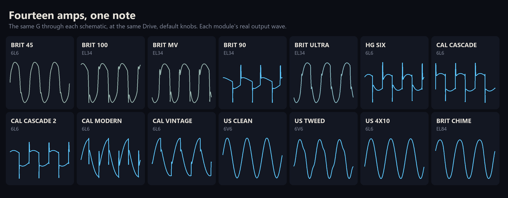
</p>

| Module | What it is | Stages | Power amp it brings |
|---|---|---|---|
| BRIT 45 | Vintage British 45 W, no master: two stages and a follower | 2 + follower | 2 x 6L6, tube-rectifier sag |
| BRIT 100 | British 100 W lead, late 60s, the bright channel, no master | 2 + follower | 4 x EL34 |
| BRIT MV | British master-volume lead, 80s, with the unbypassed 10k "cold clipper" stage | 3 + follower | 4 x EL34 |
| BRIT 90 | British 90s lead: four stages, two gain controls | 4 + follower | 4 x EL34 |
| BRIT ULTRA | British late-90s lead, the tone stack driven straight from a plate | 3 | 4 x EL34 |
| HG SIX | American high gain, early 90s: six cascaded stages, a cold clipper, local feedback on the last | 6 | 4 x 6L6 |
| CAL CASCADE | American cascading lead, early 80s: the tone stack right after the first tube, then five gain stages | 6 | 4 x 6L6 |
| CAL CASCADE 2 | The 90s version: a tighter input stage, hotter lead stages | 6 | 2 x 6L6 |
| CAL MODERN | American modern high gain, mid 90s, modern mode: no feedback | 4 + follower | 4 x 6L6 |
| CAL VINTAGE | The same amp's vintage mode: looser input stages, a treble roll-off, feedback on | 4 + follower | 4 x 6L6 |
| US CLEAN | Mid-60s American 22 W reverb combo, normal channel: the tone stack before the volume | 2 | 2 x 6V6 |
| US TWEED | 50s American 12 W combo: one tone knob, two interacting volumes | 2 | 2 x 6V6, cathode bias, no feedback |
| US 4X10 | Late-50s American 40 W tweed bass amp, bright channel: a follower into a three-knob stack | 2 + follower | 2 x 6L6, 430 V, a 2k load |
| BRIT CHIME | British 30 W top-boost combo: a two-knob stack driven by a follower | 2 + follower | 4 x EL84, cathode bias, no feedback |

The low-gain modules bring their own tubes too (6V6 and EL84, each checked against its datasheet), their
amp's plate supply and its output transformer load. Sources:
[`ModuleCircuit.h`](NeuralAmpModeler/ModuleCircuit.h) (the solver) and
[`PreampModules.h`](NeuralAmpModeler/PreampModules.h) (the circuits).
The [manual](docs/MANUAL.md#the-modular-chassis-preamp-modules-1720) has the rest.

### Example: what Drive does

The same plucked A string (110 Hz) through the Tube Lab at three settings. The top row is the
waveform; the bottom row is the harmonics a pure 110 Hz sine comes out with.

<p align="center">
  
</p>

| Setting | Drive | Stage 2 | What you hear |
|---|---|---|---|
| **Clean** | 0 dB | off | Almost no harmonics: the 2nd is 48 dB down. Warm, not dirty. |
| **Crunch** | 12 dB | off | Mostly 2nd and 3rd harmonics: the tube's asymmetric, even-order edge. |
| **Lead** | 24 dB | on | A full series of harmonics only 20-40 dB down: V1's grid clamps and V2 clips. |

The asymmetry comes from the tube itself. Push the grid toward positive and it starts drawing current
and clamps; swing it negative and the tube cuts off more gently. The Tube Lab's transfer-curve plot
shows exactly that:

<p align="center">
  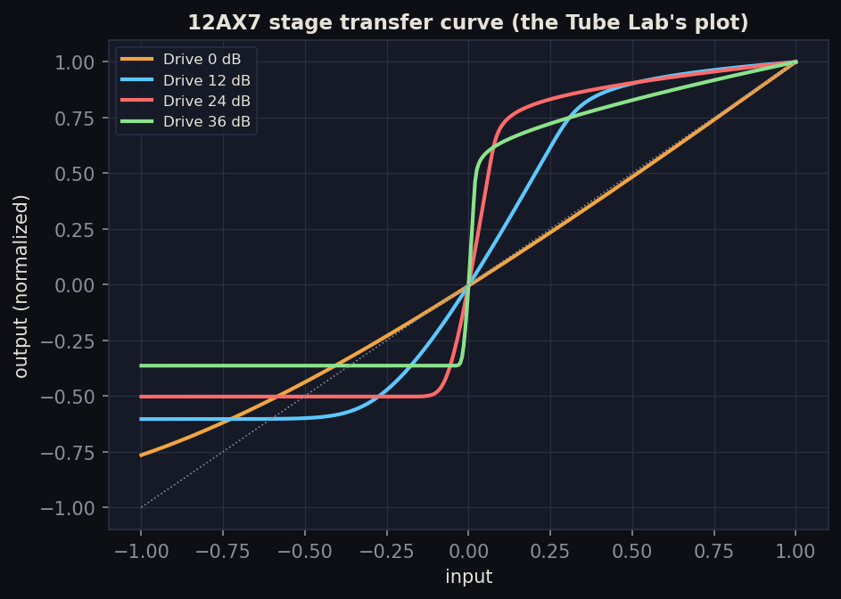
</p>

### Example: the debug page's schematic and oscilloscope

**DEBUG** (under PRESETS in the Tube Lab) opens a page that measures the simulation while you play:

<p align="center">
  
</p>

- **Circuit map:** the schematic, from the input cap through V1, V2, the tone stack, the phase
  inverter and both power tubes to the speaker. Every probe point shows its live voltage and swing,
  and turns **amber** while that part is clipping. Click a point to put it on the scope.
- **Readout:** plain English, 4 times a second: the overall feel (Clean to Saturated), where each tube
  is biased, how far it swings, how much of the time it clips and on which side, blocking, sag and CPU.
- **Oscilloscope:** two channels on any of 20 probe points, triggered (0.5-20 ms/div) or scrolling
  (50-200 ms/div), with FREEZE.
- **CSV log:** every setting and measurement, 4 rows a second, for comparing tones later.

Here is what those probe points read for the **Lead** setting above. This is the same data the scope
shows, recorded from the Tube Lab's probes:

<p align="center">
  
</p>

Reading it from the top:

1. **V1 grid-cathode** rises to **-0.2 V** and flattens there on every cycle. That's grid current: the
   grid clamps the signal and the coupling cap charges, which is what *blocking* is.
2. **V1 plate** swings from about 95 V to 231 V. Its sharp dips are the clamped peaks, inverted.
3. **V2 plate** runs flat against its ceiling for half of each cycle: the second stage is clipping
   hard, which is where most of the Lead harmonics come from.
4. **The power-tube plates** move in opposite directions (push-pull), between about 400 V and 500 V.

The probes cost about 6% of the Tube Lab's CPU, and only while the page is open or the log is
running. The sound is bit-for-bit the same with them on or off.

---

## Cab Lab: place the mics in 3D

<p align="center">
  
</p>

**CAB LAB** models the speaker cab and the mics on it. Its **SPEAKER LAB** page shows the cab from
the front, the side and in 3D, and you drag the mics where you want them:

- **Cabs:** 4x12, 2x12, 1x12 or 4x10, with a choice of speakers, or your own IR. Switch to **Dual** for
  two cabs at once, and put each mic on either one.
- **Four mics** from ten types (SM57, R-121 ribbon, MD421, U87, C414 and more). Each has its own X, Y
  and Z (distance from the grille), level, pan and polarity flip.
- **What you hear, explained:** the response graph shows each close mic and the blend. The readout
  says how far the mic is from each cone, how far off axis, and how much proximity bass it picks up.

---

## EQ with a live analyzer

<p align="center">
  
</p>

Two EQs share one engine: **PRO EQ**, a block you can place anywhere in the chain, and the
**Output EQ**, the last thing before Master Out. Each has 8 bands, and any band can be a bell, a low
or high shelf, a 12-48 dB/oct low or high cut, or a notch. Drag a node to set its frequency and gain,
use the mouse wheel for Q, and double-click to switch a band on or off. Moves glide, so nothing
zippers or clicks, and the curve on screen is computed from the same filters the audio runs.

The **ANALYZER** shows the spectrum going in and coming out. It starts off and remembers your
choice, so it only uses CPU and GPU when you want it.

### Example: tightening a high-gain rig

Four bands: cut the low end below 90 Hz, take 4 dB of mud out at 320 Hz, add 3 dB of bite at 1.7 kHz,
and roll off the fizz above 7 kHz.

<p align="center">
  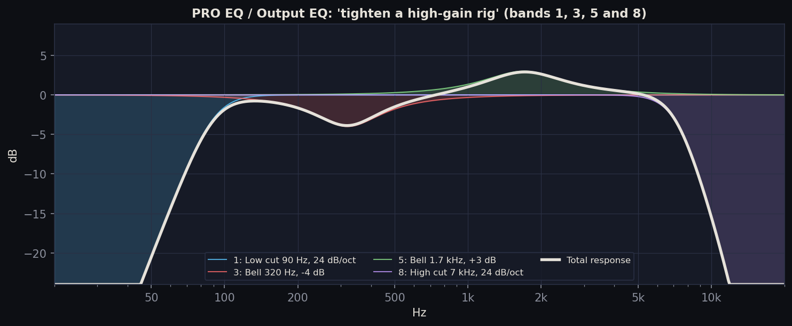
</p>

The Lead tone from the Tube Lab example, through that EQ, as the analyzer's IN/OUT view shows it:

<p align="center">
  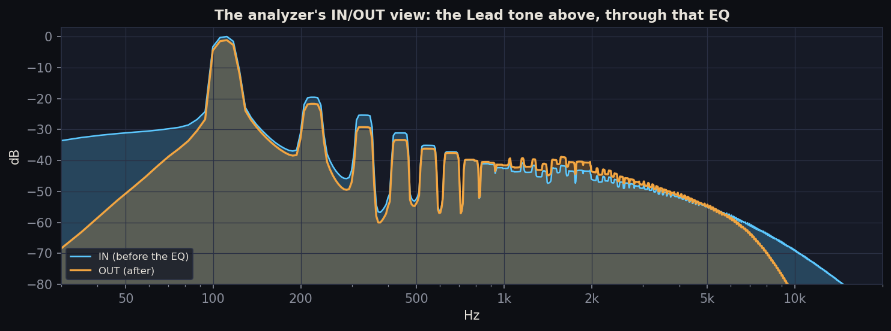
</p>

The rumble under 90 Hz drops by 30 dB or more, the harmonics around 300 Hz come down, the 1-2 kHz
range comes forward, and the top octave falls away instead of fizzing.

---

## Everything else

- **Cab IRs:** besides CAB LAB, there are three IR loaders: CAB, CAB 2 and CAB 3.
- **Capture packs:** the **PACK** dropdown in the AMP block switches between the captures of one pack
  (a folder or a `.zip`), level-matched.
- **Tap tempo:** **TAP** in the top bar (or a footswitch) sets the tempo, and each delay follows it as
  a 1/4, dotted 1/8, 1/8, triplet or 1/16 note.
- **GATE and PRO COMP:** a gate that can key off your clean guitar even when it sits after a
  high-gain amp, and a studio compressor with Clean, Opto and FET styles and a gain-reduction meter.
- **Pedals:** up to three copies of each effect, each with its own knobs and popup.
- **A/B amp slots:** two amp captures, each with its own cab IRs, switchable instantly.
- **MIDI:** click **MIDI** in the top bar to map footswitches and expression pedals to any knob or switch.
- **Output:** Master Out, a lookahead limiter (0.7 ms), a soft safety clip, and stereo **Width** (0%
  sums left and right for a single speaker).
- **Themes:** several color themes, in light or dark.
- **Display:** Settings has AUDIO, DISPLAY and ABOUT tabs: a 30 or 60 fps cap and five window resolutions.

---

## Built to stay light

- Anything you can't see or haven't switched on doesn't run: the debug probes, the spectrum
  analyzers and the tuner's pitch search all stop when they're hidden, and blocks that are off or
  not cabled in are skipped.
- The amp-capture engine has a hand-written SSE kernel plus an AVX2/FMA one picked at run time
  (about 5x faster than the generic matrix code), and cab IRs use a zero-latency partitioned FFT.
- The UI only redraws what changes, clipped in hardware, so the meters don't redraw the whole window.
- The UI runs at 30 fps by default, and the 3D chassis redraws only for changes you can see.
- On an ordinary laptop, a full rig runs at a 128-sample buffer: about 5.3 ms round trip plus the
  interface's driver.

---

## Building from source

Windows x64 with the Visual Studio 2019 Build Tools. The libraries are git submodules pinned to the
commits this was built on, and the changes to them are kept as patches in [`patches/`](patches/).

```powershell
git clone --recursive https://github.com/Gwojtowicz/Griffin-Amplification.git
cd Griffin-Amplification
powershell -ExecutionPolicy Bypass -File scripts\apply-patches.ps1     # or: bash scripts/apply-patches.sh
cd iPlug2/Dependencies/IPlug; bash ./download-vst3-sdk.sh v3.8.1_build_84; cd ../../..
cd iPlug2/Dependencies; bash ./download-prebuilt-libs.sh; cd ../..

cd NeuralAmpModeler
MSBuild.exe NeuralAmpModeler.sln /t:NeuralAmpModeler-app  /p:Configuration=Release /p:Platform=x64 /p:PlatformToolset=v142
MSBuild.exe NeuralAmpModeler.sln /t:NeuralAmpModeler-vst3 /p:Configuration=Release /p:Platform=x64 /p:PlatformToolset=v142
```

The app ends up in `NeuralAmpModeler/build-win/app/x64/Release/`. (The source folders keep their
original names, so the build and saved settings stay compatible.) The VST3's last build step copies
it into `C:\Program Files\Common Files\VST3`, which needs an admin prompt. See the
[manual](docs/MANUAL.md#building) for details.

---

## Documentation

- **[The full manual](docs/MANUAL.md):** every block and setting, the Tube Lab's circuit math stage by
  stage, oversampling, levels, MIDI and the saved-state format.
- **[CHANGELOG.md](CHANGELOG.md):** every version, with measurements.

---

## License and credits

Griffin Amplification is open source under the **MIT license**: see [LICENSE](LICENSE).

It's built on [Neural Amp Modeler](https://www.neuralampmodeler.com), Steven Atkinson's open-source
plug-in and core library ([source](https://github.com/sdatkinson/NeuralAmpModelerPlugin), MIT), whose
copyright notice is kept in [LICENSE](LICENSE) as that license requires. It's an independent project
and isn't affiliated with or endorsed by the NAM authors or TONE3000. The bundled libraries keep their own licenses:
[iPlug2](https://iplug2.github.io) (zlib-style), the core amp-model library and AudioDSPTools (MIT),
Eigen (MPL-2.0) and the VST3 SDK (MIT). See `NeuralAmpModeler/installer/ThirdPartyNotices.txt`.

The Tube Lab and tuner build on published research:
K. Dempwolf and U. Zölzer, *A Physically-motivated Triode Model for Circuit Simulations* (DAFx 2011);
N. Koren, *Improved VT models for SPICE simulations*; P. McLeod and G. Wyvill, *A Smarter Way to Find
Pitch*; R. Bristow-Johnson, *Audio EQ Cookbook*.
